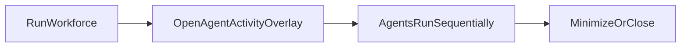

# UI Enhancement — Agent Activity Overlay

**Product:** Personal AI Workforce Studio  
**Document type:** UX + technical design  
**Status:** Implemented (full-width takeover panel) — see [`src/ui/agent_activity_overlay.py`](src/ui/agent_activity_overlay.py)  
**Related code:** [`pages/2_Workforce_Studio.py`](pages/2_Workforce_Studio.py), [`src/ui/agent_activity_overlay.py`](src/ui/agent_activity_overlay.py), [`src/ui/agent_cards.py`](src/ui/agent_cards.py), [`src/ui/workflow_view.py`](src/ui/workflow_view.py), [`src/orchestration/runner.py`](src/orchestration/runner.py)

---

## 1. Goal

When a user clicks **Run Workforce**, open a focused **Agent Activity** screen (overlay / takeover panel) so workshop participants can see:

- Which agent is running now
- What that agent’s job is (plain language)
- What the code is doing at this step (validate, call model, validate schema, hand off)
- What input it received and what output it produced
- Where the work goes next

The overlay exists so the experience feels **visible, not magical** — aligned with the PRD experience principles — especially during Live Mode when each agent may take several seconds.

---

## 2. Problem with the current UI

After **Run Workforce** today:

| What exists | Gap |
| --- | --- |
| Inline `st.progress` + `st.status` updated via `on_update` | Easy to miss; buried among the task form |
| Agent cards, pipeline chips, activity feed, inspector | Mostly useful **after** the run finishes |
| No modal / takeover while agents run | Users do not get a “what is happening in the code” narrative mid-flight |
| Live runs are slow per agent | Status text alone does not teach Orchestrator → Research → Planning → Execution → Reviewer |

**User need:** A pop-up style screen that stays in focus for the duration of the run and explains each agent as it starts, works, and completes.

---

## 3. Trigger and lifecycle



**Open when**

- **Run Workforce** validation succeeds and the run starts (`run_in_progress = true`).
- Human **Request Revision** re-enters the graph (same overlay, labelled as revision).

**Stay open while**

- Status is any running / revision state (`RESEARCH_RUNNING`, `PLANNING_RUNNING`, `EXECUTION_RUNNING`, `REVIEW_RUNNING`, `REVISION_RUNNING`, etc.).

**Auto-complete / allow dismiss when**

- `AWAITING_HUMAN_APPROVAL` — show success summary, primary CTA: **Continue to review & approve**
- `FAILED` — show failed stage + safe error detail, CTA: **Close** / **Inspect run**
- `CANCELLED` — show cancelled message, CTA: **Close**

**Manual controls**

- **Minimize** — hide overlay; main page cards/feed remain available
- **Expand** — reopen overlay from a sticky “Run in progress” chip
- Do not allow starting a second concurrent run while overlay is active

---

## 4. Screen layout (wireframe)

```text
+------------------------------------------------------------------+
| Agent Activity                          Demo | Live   Run abc123 |
| Progress: [=========>          ]  Research running · 12.4s       |
+----------------+---------------------------+---------------------+
| Pipeline       | Current agent             | Handoff packets     |
|                |                           |                     |
| User Task  ok  | RESEARCH                  | Input (summary)     |
| Orchestrator ok| What this agent does:     | - Task objective    |
| Research  RUN  | Discovers themes,         | - Constraints       |
| Planning wait  | evidence gaps, limits.    |                     |
| Execution wait |                           | Output (summary)    |
| Reviewer wait  | What the code is doing:   | - Key findings (n)  |
| Human wait     | 1. Build research prompt  | - Limitations       |
|                | 2. Optional search tool   | [Show raw JSON]     |
|                | 3. Call LLM for JSON      |                     |
|                | 4. Validate ResearchPacket|                     |
|                | 5. Hand off to Planning   |                     |
|                |                           |                     |
|                | Last event:               |                     |
|                | Research Agent started.   |                     |
+----------------+---------------------------+---------------------+
| Activity feed (newest first)                                     |
| 12:01:02 research · running · Research Agent started.            |
| 12:01:01 orchestrator · completed · Specification created.       |
+------------------------------------------------------------------+
| [Minimize]                              [Close when finished]    |
+------------------------------------------------------------------+
```

### Layout regions

1. **Header** — Product context (“Agent Activity”), execution mode badge (Demo / Live), short run id, overall progress bar, current stage label, elapsed time.
2. **Left — Pipeline** — Sequential nodes matching existing pipeline: User Task → Orchestrator → Research → Planning → Execution → Reviewer → Human Approval → Final Output. Active node highlighted; completed / failed / needs-revision use **text labels** as well as colour.
3. **Center — Current agent panel**
   - Agent name + icon
   - **What this agent does** (static role copy)
   - **What the code is doing now** (step list for the active stage)
   - Elapsed time for this agent (from `agent_executions` / events)
   - Last human-readable event message
4. **Right — Handoff packets**
   - Sanitised **input** summary (no secrets)
   - Sanitised **output** summary when available
   - Expander: raw JSON for engineers (Agent Lab audience)
5. **Footer — Activity feed** — Same event model as today (`events[]`), newest first, capped list.

---

## 5. Per-agent plain-language copy

Map to roles already defined in [`src/ui/agent_cards.py`](src/ui/agent_cards.py).

| Stage key | Title | What this agent does | What the code is doing (typical steps) |
| --- | --- | --- | --- |
| `orchestrator` | Orchestrator | Validates your request and turns it into a clear task specification and success criteria. | Validate input → create `TaskSpec` → emit events → hand off to Research |
| `research` | Research | Finds themes, assumptions, gaps, and (if configured) live search evidence. Never invents fake URLs. | Optional Firecrawl search → build prompt → LLM JSON → validate `ResearchPacket` → strip bad citations → hand off to Planning |
| `planning` | Planning | Turns research into prioritised actions, timing estimates, risks, and dependencies. | Load research + task → LLM JSON → validate `Plan` → hand off to Execution |
| `execution` | Execution | Writes the briefing / action plan deliverable in Markdown plus structured metadata. | Load research + plan → LLM JSON → validate `Deliverable` → hand off to Reviewer |
| `reviewer` | Reviewer | Independently checks quality; may request one bounded revision. Does **not** human-approve. | Load deliverable + criteria → LLM JSON → validate `ReviewReport` → route revise or pause for human |
| `human_approval` | Human Approval | You decide: Approve, Request Revision, or Reject. No emails or external actions. | Wait for explicit button → record decision + timestamp |

**Demo Mode callout (always visible in overlay when `mode=demo`):**  
“Illustrative fixtures — no live LLM or web search in this run.”

**Live Mode callout:**  
“Task text is sent to the configured model provider. Search runs only if Firecrawl is configured.”

---

## 6. Data source (reuse existing run state)

No new side-effect tools. Drive the overlay entirely from existing `run_state`:

| Field | Use in overlay |
| --- | --- |
| `run_id`, `mode`, `status`, `current_stage` | Header + lifecycle |
| `node_states` | Pipeline node labels |
| `events` | Activity feed + “last event” |
| `agent_executions` | Duration, input/output packets, errors |
| `task_specification`, `research`, `plan`, `deliverable`, `review` | Summaries when present |
| `revision_count` / `max_revisions` | Show “Revision 1 of 1” when applicable |
| `error` / event `metadata.issues` | Failed-stage detail (safe messages only) |

Sanitisation must continue to strip API keys / secrets (same rules as [`src/orchestration/events.py`](src/orchestration/events.py)).

### Suggested summary extractors (future code)

- Research: count of `key_findings`, whether `evidence_items` is empty, first limitation line  
- Plan: number of actions, top 3 titles  
- Deliverable: title + first lines of executive summary  
- Review: status + quality_score (labelled as model assessment)

---

## 7. Streamlit constraints and recommended approach

Streamlit does not provide a full browser modal like a SPA. For a later implementation phase, prefer (in order):

1. **`st.dialog`** (if available in the pinned Streamlit version) opened when the run starts, refreshed as state updates.  
2. **Full-width takeover container** at the top of Workforce Studio (`st.container` + session flag `show_agent_overlay`) that replaces the main monitoring area while `run_in_progress`.  
3. **Expanded `st.status`** block as a fallback, with structured markdown sections matching the wireframe.

**Update model:** keep synchronous sequential execution with `on_update(state)` callbacks (already used in Workforce Studio). Each callback should refresh overlay widgets via `st.empty()` placeholders or dialog rerun patterns — without fragile background threads unless tests cover them.

**Do not** block without feedback; **do not** invent parallel agent UI for the sequential MVP.

---

## 8. Accessibility and workshop readability

- Status must include **text** (Waiting / Running / Completed / Needs revision / Failed), not colour alone.
- Use large type suitable for a projector; avoid dense monospace in the default view.
- Raw JSON stays behind an expander labelled for technical participants.
- Icons support recognition; labels remain authoritative.
- Keyboard: primary actions reachable (Close / Minimize / Continue to approval).

---

## 9. Out of scope (this document and first coding pass)

- No application code changes as part of authoring this file
- No new model/search providers
- No parallel agent execution visualisation
- No external side effects (email, calendar, purchases)
- No change to LangGraph stage order or approval rules
- Not a full observability product

---

## 10. Suggested future implementation checklist

When implementation is approved (separate change):

1. Add `src/ui/agent_activity_overlay.py` with `render_agent_activity_overlay(run_state, *, running: bool)`.
2. Add plain-language copy constants (table in §5) next to or inside that module — keep prompts out of UI.
3. In [`pages/2_Workforce_Studio.py`](pages/2_Workforce_Studio.py), set `show_agent_overlay=True` on run start; call overlay render from `on_update` and after completion.
4. Wire Minimize / Expand via `st.session_state`.
5. On `AWAITING_HUMAN_APPROVAL` / `FAILED`, switch overlay to completion/failure footer CTAs.
6. AppTest / smoke: overlay flag set during demo run; pipeline labels present; no secrets in rendered event text.
7. Manual workshop check on projector width.

---

## 11. Success criteria (when later built)

- Clicking **Run Workforce** opens the Agent Activity view before/at first agent start.
- Active agent is obvious from across a meeting-room table.
- A non-technical attendee can explain what Research vs Reviewer is doing after one Demo run.
- Engineers can still open raw JSON for handoffs.
- Demo disclaimer and Live disclosure remain visible.
- Failed runs show which stage failed and a safe, specific message when available.

---

## 12. Document history

| Version | Note |
| --- | --- |
| 1.0 | Design-only write-up based on current Streamlit Workforce Studio behaviour; no code shipped with this file. |
| 1.1 | Implemented takeover overlay + `graph.stream` per-stage `on_update` in Workforce Studio. |
