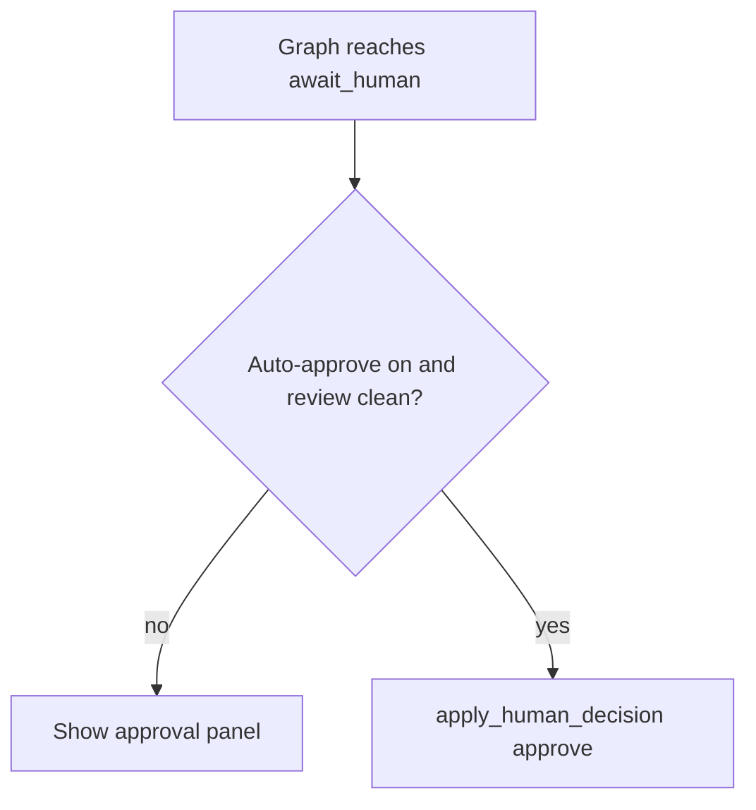
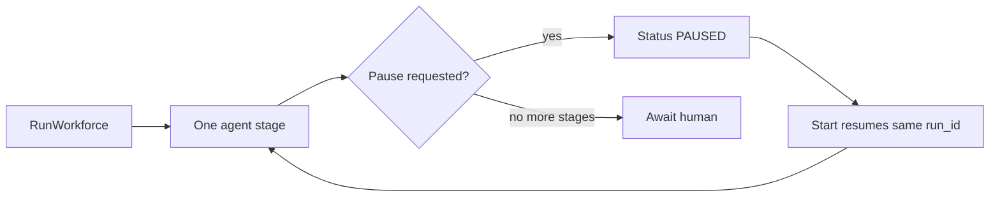
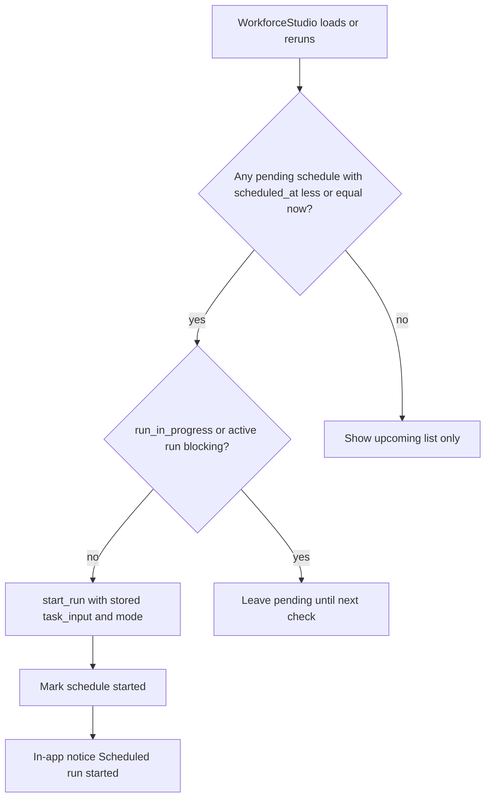

# UX Enhancement — Auto-Approval, Notices, Pause / Start, Schedule / Run Now

**Product:** Personal AI Workforce Studio  
**Document type:** UX + technical design (design only)  
**Status:** Design only — no application code ships with this file  
**Related code:** [`pages/2_Workforce_Studio.py`](pages/2_Workforce_Studio.py), [`pages/1_Task_Manager.py`](pages/1_Task_Manager.py), [`src/persistence/task_repository.py`](src/persistence/task_repository.py), [`src/services/run_service.py`](src/services/run_service.py), [`src/orchestration/runner.py`](src/orchestration/runner.py), [`src/orchestration/nodes.py`](src/orchestration/nodes.py), [`src/ui/output_views.py`](src/ui/output_views.py), [`src/ui/components.py`](src/ui/components.py), [`src/ui/agent_activity_overlay.py`](src/ui/agent_activity_overlay.py)  
**Sibling doc:** [`UIenhancement.md`](UIenhancement.md) (Agent Activity overlay — already implemented)

---

## 1. Goal

Make Workforce Studio easier to use in a workshop without changing the agent order or inventing external side effects. This document proposes four product enhancements for a later coding pass:

1. **Opt-in auto-approval** — a visible session setting so the user can skip the final Approve click when the run is clean.
2. **In-app completion notice** — a toast plus dismissible banner when a run finishes, fails, pauses, or reaches the human gate.
3. **Pause and Start (resume)** — stop after the current agent stage and continue the same `run_id` later.
4. **Schedule or Run now** — choose immediate start or a future local datetime; due schedules start only if Workforce Studio is open (poll on load / rerun). No background worker.

This file is research and design only. Creating or updating it does not change Python, tests, styles, or config.

---

## 2. What the app does today

| Area | Current behaviour | Gap |
| --- | --- | --- |
| Run loop | [`WorkforceRunner.run`](src/orchestration/runner.py) streams the full LangGraph in one call; Workforce Studio sets `run_in_progress` and disables **Run Workforce** until the call returns | The page cannot process new clicks mid-run; there is no pause |
| Human gate | Graph always ends at `await_human` with `AWAITING_HUMAN_APPROVAL` ([`await_human_node`](src/orchestration/nodes.py)) | User must scroll to the approval panel and click Approve / Request Revision / Reject |
| Approval | [`render_approval_panel`](src/ui/output_views.py) + [`RunService.apply_human_decision`](src/services/run_service.py) | Reviewer “approved” never sets `HUMAN_APPROVED`; there is no auto-approve path |
| Completion signal | Status string, overlay CTAs, approval panel below outputs | No toast, banner, or cross-page notice when the workforce finishes |
| Reset | Clears session state after confirm | Cannot stop an in-flight LLM / graph step |
| Start timing | Single primary action **Run Workforce** starts immediately in the same script run | No way to pick a future time; Task Manager stores templates only — no `scheduled_at` or pending-run queue |

**PRD note (FR-04):** the orchestrator must never silently bypass human approval. Auto-approval in this design is an **explicit user opt-in** that still records a human-origin decision, not a silent system bypass.

---

## 3. Related friendliness observations

These are context for the four features above; they are not separate build items in this document:

- Approval controls sit under the output tabs and are easy to miss after a long Live run.
- Status codes (`AWAITING_HUMAN_APPROVAL`, `REVIEW_RUNNING`, etc.) are engineer-facing; the Agent Activity overlay already softens mid-run copy.
- The blocking run freezes the rest of the page until the graph returns — pause-after-stage and completion notices address the workshop feel of that constraint within Streamlit’s model.
- Workshop demos often want “run this in a few minutes” without a separate cron stack; Schedule / Run now covers that within Streamlit’s while-open model.

---

## 4. Opt-in auto-approval

### 4.1 Intent

Let a workshop participant turn on **Auto-approve when the run is ready** before starting. When the graph reaches a clean human gate, the app records approval without requiring another click. Default remains **off**.

### 4.2 Placement (later UI)

- Workforce Studio task workspace, near mode / run controls.
- Label example: **Auto-approve when ready (skips the Approve button for this session)**.
- Caption: explain that the person is choosing this; the activity feed will show that auto-approval came from the setting.
- Store only in `st.session_state` (e.g. `auto_approve_enabled`). Do **not** turn it on via a silent env default. A browser refresh starts with auto-approve off again.

### 4.3 Rules

1. The graph still runs through `await_human` and still sets `AWAITING_HUMAN_APPROVAL`. Auto-approve is a **post-step**, not a graph shortcut that skips the node.
2. After `start_run` (or a revision re-entry) returns, if status is `AWAITING_HUMAN_APPROVAL` **and** the session setting is on **and** the run is “clean,” call the existing `apply_human_decision(..., decision="approve")` with a fixed note such as `Auto-approved from user setting`.
3. **Clean** means: reviewer status is not `revision_required`, `unresolved_issues` is empty, and status is not `FAILED`.
4. Persist `approval_status=approved`, `approval_at`, `approval_note`, and an event (e.g. `human_approved` / message “Auto-approved from user setting”) so Run History still shows a human-origin decision.
5. If the setting is off, or the run is dirty / failed, show the normal approval panel.
6. Changing the toggle mid-run does not retroactively approve; it applies to the next completed gate for that session after the setting was on when the gate was evaluated.

### 4.4 Safety callout

This is a deliberate product exception to “never skip the approval button.” It must stay:

- Off by default
- Visible in the UI while enabled
- Auditable in the activity feed and persisted run record
- Unavailable as a silent server-side default

It does **not** skip the Reviewer agent, invent external actions, or mark reviewer approval as human approval by itself.

---

## 5. In-app completion notice

### 5.1 Intent

When a run leaves a running state, tell the user clearly that something finished — especially when they need to approve, or when auto-approve already completed the gate.

### 5.2 Streamlit reality

Streamlit has no OS / browser push notification API for this app. Design for **in-session** notice only:

- `st.toast(...)` for a short ephemeral cue
- A dismissible banner (shared helper in [`src/ui/components.py`](src/ui/components.py)) so the message remains after the script reruns

### 5.3 Notice payload (session)

Store one notice in `st.session_state`, for example:

| Field | Purpose |
| --- | --- |
| `message` | Human-readable text |
| `level` | `info` / `success` / `warning` / `error` |
| `run_id` | Tie notice to the run that produced it |
| `created_at` | Timestamp |
| `dismissed` | Hide banner until the next notice |

Do **not** emit a notice on every `on_update` snapshot. Emit once when the run leaves the running / revision loop.

### 5.4 Trigger copy

| Resulting status | Suggested message | Level |
| --- | --- | --- |
| `AWAITING_HUMAN_APPROVAL` | Workforce finished. Your approval is waiting. | info |
| `HUMAN_APPROVED` via auto-approve | Workforce finished and was auto-approved. | success |
| `FAILED` | Workforce failed at {stage}: {safe error} | error |
| `PAUSED` | Paused after {stage}. Resume when ready. | warning |
| Scheduled run begins | Scheduled run started. | info |

Manual Approve / Reject can keep the existing success panel; optional short toast is fine but not required for this design’s core cases.

### 5.5 Limits

- While `start_run` blocks inside Workforce Studio, Streamlit cannot show a notice on another page until that script returns. True background completion needs a later architecture change and is **out of scope**.
- Notices are session-local; they are not written to SQLite as a separate table (run events already record completion).

---

## 6. Pause and Start (resume)

### 6.1 Intent

Give the user control during a long Live run: **Pause** after the current agent finishes its stage; **Start** resumes the same run from that checkpoint.

### 6.2 What pause means (and does not mean)

| In scope | Out of scope |
| --- | --- |
| Stop **after** the current agent stage completes | Mid-token / mid-HTTP cancel of LiteLLM or Firecrawl |
| Persist partial `run_state` with status `PAUSED` | Inventing parallel agents |
| Resume with the same `run_id` | Resuming `FAILED` or already human-decided runs |

A Pause button pressed while `graph.stream` is inside a single long Python call cannot be observed until that call returns. Cancelling an in-flight provider request is unsafe for this MVP. Therefore: **pause-after-stage**, not hard interrupt.

### 6.3 Recommended later design

1. Add run status `PAUSED` and field `paused_after_stage` (stage key just completed).
2. Prefer running **one stage per script execution** (or checking a pause request between stages). After a stage snapshot, if pause was requested, set `PAUSED`, persist via `RunRepository.save_run`, return control to Streamlit.
3. **Start** (resume) is enabled only when `status == "PAUSED"`. It continues remaining nodes for the same `run_id` and must not mint a new run id.
4. **Run Workforce** remains the control that begins a **new** task (or the Run-now path). Do not overload it as resume of a paused run.
5. Overlay / pipeline should show a clear **Paused** node label (text, not colour alone).
6. Failed or human-approved / rejected runs do not resume.

### 6.4 UI controls (later)

| Control | When visible | Behaviour |
| --- | --- | --- |
| Pause | During an active multi-stage run (between stages or before next stage starts) | Queue pause; after current stage, status becomes `PAUSED` |
| Start | When `status == "PAUSED"` | Resume remaining graph for same `run_id` |
| Run Workforce | Idle / no conflicting active run; when timing mode is Run now | New run from the form |

Show the completion notice when entering `PAUSED` (see §5).

### 6.5 Persistence

Paused runs use the existing save path (`_persist` / `RunRepository`). Resume loads the saved state (session first; history reopen can be a follow-on). Resume must restore `events`, `agent_executions`, packets, and `revision_count` without resetting them.

---

## 7. Schedule or Run now

### 7.1 Intent

Let the user either **run immediately** (today’s behaviour) or **schedule** a one-shot run for a future local date and time. When the due time arrives **and Workforce Studio is open**, the app starts the stored task via the existing `RunService.start_run`. If the browser was closed past the due time, the user recovers with an overdue banner — not a silent drop and not a background worker.

### 7.2 Placement (later UI)

On Workforce Studio next to the run controls:

- Radio or segmented control: **Run now** (default) | **Schedule**
- When **Schedule**: date + time inputs; show the user’s local timezone; caption that the app must stay open on Workforce Studio for the run to start automatically
- Primary button label switches: **Run Workforce** vs **Schedule run**
- **Upcoming** list of pending (and overdue) schedules: task snippet, mode, due time, with **Cancel** and **Run now** (start early / recover overdue)

Task Manager templates remain reusable definitions only. Scheduling does **not** add `scheduled_at` onto templates; a schedule is a separate one-shot run intent that snapshots the form (or loaded template) at schedule time.

### 7.3 Pending-run model (later build)

| Field | Purpose |
| --- | --- |
| `schedule_id` | Unique id |
| `task_input` | Snapshot of task / background / constraints / horizon / format at schedule time |
| `mode` | `demo` or `live` |
| `scheduled_at` | ISO UTC datetime |
| `status` | `pending` / `started` / `cancelled` / `missed` |
| `created_at` | When the user scheduled it |

**Persistence shape:** JSON files under `data/scheduled_runs/` (same spirit as task JSON under `data/tasks/`), or a small SQLite `scheduled_runs` table. Prefer a dedicated store — do not mutate [`TaskRepository`](src/persistence/task_repository.py) packets into schedules.

### 7.4 Fire-while-open behaviour

Rules:

1. On Workforce Studio script start (and optionally a light `st.fragment` / manual refresh), load pending schedules and compare `scheduled_at` to now (UTC).
2. If due and no conflicting active run (`run_in_progress`, pause-in-progress conflict, or awaiting approval that should not be overwritten without confirm), call existing `RunService.start_run` with the stored snapshot and mode; mark schedule `started`; emit notice “Scheduled run started” (§5).
3. If the browser/session was closed past the due time: keep the item recoverable with an **Overdue** banner and **Run now** / **Cancel** actions (workshop-safe). Optionally set status `missed` when cancelled or explicitly dismissed; do not delete silently.
4. Scheduling does **not** bypass human approval. When the scheduled run finishes, normal approval / auto-approve rules (§4) still apply.
5. Live Mode credentials are checked at **start** time (when due or when the user clicks Run now on a schedule). If credentials are missing, fail with a clear notice; never silently switch to Demo Mode.
6. A given `schedule_id` starts at most once (`pending` → `started`).

### 7.5 UI controls (later)

| Control | When visible | Behaviour |
| --- | --- | --- |
| Run now / Schedule | Always near run controls | Selects timing mode; default Run now |
| Run Workforce | Timing = Run now; idle | Immediate `start_run` from form (unchanged path) |
| Schedule run | Timing = Schedule; valid future datetime | Persist pending schedule; show in Upcoming |
| Upcoming → Run now | Pending or overdue item | Start immediately with stored snapshot; mark `started` |
| Upcoming → Cancel | Pending or overdue item | Mark `cancelled` (or remove from active list) |

### 7.6 Limits

- No OS cron, Celery, or runs while the browser is closed.
- No recurring schedules in this design.
- No email / push reminder at due time (in-app notice only when Studio is open and the run starts or is overdue).
- Community Cloud / ephemeral `data/` caveat still applies: scheduled JSON may reset on redeploy — call out in About / Setup later if implemented.

---

## 8. Suggested hook points (future implementation)

When coding is approved in a separate change:

| Enhancement | Primary touch points |
| --- | --- |
| Auto-approval | Session toggle in [`pages/2_Workforce_Studio.py`](pages/2_Workforce_Studio.py); after `start_run` / revision returns, conditional `RunService.apply_human_decision`; event message for audit |
| In-app notice | Helper in [`src/ui/components.py`](src/ui/components.py); set notice once on terminal / pause / await-human / scheduled-start transitions in Workforce Studio; optional toast |
| Pause / Start | Stage-gated loop or interrupt check in [`src/orchestration/runner.py`](src/orchestration/runner.py); status + `paused_after_stage` in state; buttons + disabled rules in Workforce Studio; persist via existing repository |
| Schedule / Run now | Timing radio + datetime + Upcoming list in Workforce Studio; new scheduled-run store under `data/`; due-check at page load / rerun before allowing a conflicting new run; reuse `RunService.start_run` |

Reuse sanitisation rules from [`src/orchestration/events.py`](src/orchestration/events.py) for any new event metadata.

---

## 9. Streamlit constraints (summary)

- One script run at a time; long `graph.stream` blocks click handling until it returns.
- Prefer stage boundaries for pause; avoid background threads unless tests cover them.
- Toasts do not replace a dismissible banner after rerun.
- No OS notifications without leaving the Streamlit workshop model.
- Scheduled starts only happen when Workforce Studio loads or reruns; closed-tab fire is impossible without an external worker.

---

## 10. Accessibility and workshop readability

- Pause / Start / Auto-approve / Schedule labels must be plain language; include status **text** (Paused, Awaiting approval, Auto-approved, Scheduled, Overdue).
- Auto-approve caption must state that the person opted in.
- Schedule caption must state that the Studio page must stay open for automatic start.
- Notices must be readable on a projector; keep messages short.
- Keyboard: primary actions (Start, Pause, Approve, Schedule run, Dismiss notice, Cancel schedule) remain reachable.

---

## 11. Out of scope

**This document (authoring):**

- No application code, tests, styles, or config changes
- No edits to [`UIenhancement.md`](UIenhancement.md)

**The later build this document describes:**

- Email, SMS, or browser push notifications
- Background workers, OS cron, or runs while the browser is closed
- Recurring schedules
- Cancelling an in-flight HTTP / LLM call mid-request
- Skipping the Reviewer agent
- Silent env-default auto-approve
- Parallel agent execution
- Changing LangGraph stage order
- External side effects (email, calendar, purchases)
- Turning Task Manager templates into schedules in-place

---

## 12. Suggested future implementation checklist

1. Add session toggle `auto_approve_enabled` (default `False`) on Workforce Studio with clear caption.
2. After a successful graph finish at `AWAITING_HUMAN_APPROVAL`, if toggle on and review clean, call `apply_human_decision(..., decision="approve", note="Auto-approved from user setting")` and persist.
3. Add `queue_run_notice(...)` / `render_run_notice()` in shared UI components; wire once on await-human, auto-approve success, fail, pause, and scheduled start.
4. Introduce `PAUSED` + `paused_after_stage`; change runner / studio loop to honour pause between stages.
5. Add **Pause** and **Start** buttons with mutual exclusion against a second concurrent new run.
6. Persist paused and auto-approved runs; ensure Run History labels show the new statuses.
7. Add Run now / Schedule timing control, datetime inputs, and Upcoming list on Workforce Studio.
8. Add scheduled-run persistence (`data/scheduled_runs/` or SQLite); due-check on Studio load/rerun; mark `started` once; overdue banner with Run now / Cancel.
9. Tests: auto-approve only when enabled and clean; notice set once; pause returns `PAUSED` with same `run_id`; Start resumes remaining stages; schedule persists and fires once when due while Studio open; overdue recoverable; Live due-start fails clearly without credentials; reviewer-approved alone still does not imply human-approved without the opt-in path or button.
10. Manual workshop check: Live Mode long run → Pause → Start → notice → optional auto-approve; Schedule a run a minute ahead with Studio open → auto-start → approval path.

---

## 13. Success criteria (when later built)

- Auto-approve is off by default; with it on, a clean Demo run ends at `HUMAN_APPROVED` with an auditable auto-approve event.
- A dirty review or failed run still shows the manual approval panel or failure UI.
- Finishing a run shows an in-app toast and dismissible banner with the right message for await / auto-approve / fail / pause / scheduled start.
- Pause stops after the current stage; Start continues the same `run_id` without losing prior packets or events.
- **Run now** keeps today’s immediate path; **Schedule** saves a pending item visible in Upcoming.
- With Studio open past due time, the run starts once and the schedule becomes `started`.
- Overdue items are recoverable via **Run now** / **Cancel**; closed-browser true background fire remains out of scope.
- Demo disclaimer, Live disclosure, and “no external actions” safety notes remain intact.

---

## 14. Document history

| Version | Note |
| --- | --- |
| 1.0 | Design-only write-up for auto-approval, in-app completion notices, and pause/resume; grounded in current Workforce Studio / runner / approval behaviour; no code shipped with this file. |
| 1.1 | Added Schedule or Run now: Run now vs Schedule UI, pending-run model, fire-while-Studio-open poll, overdue recovery; design only, no code. |
