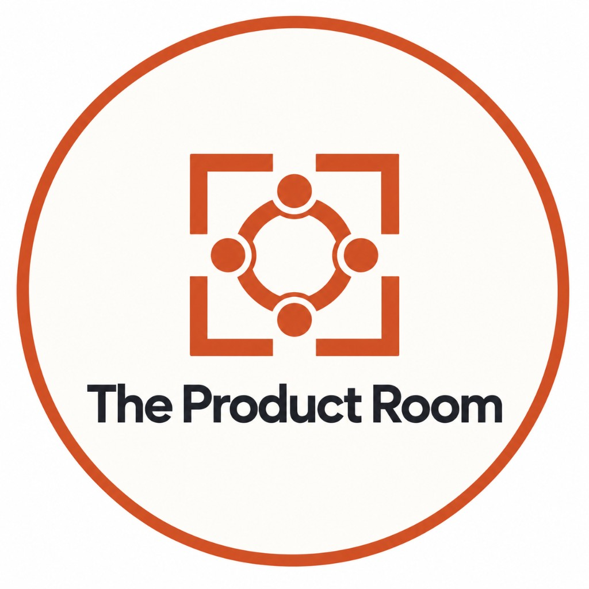
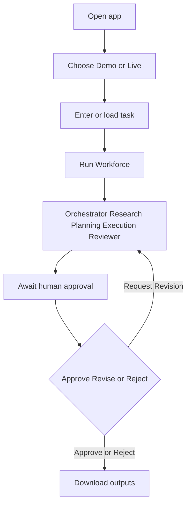
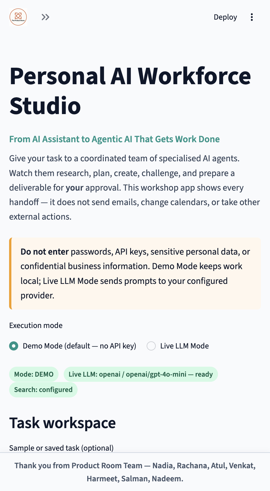
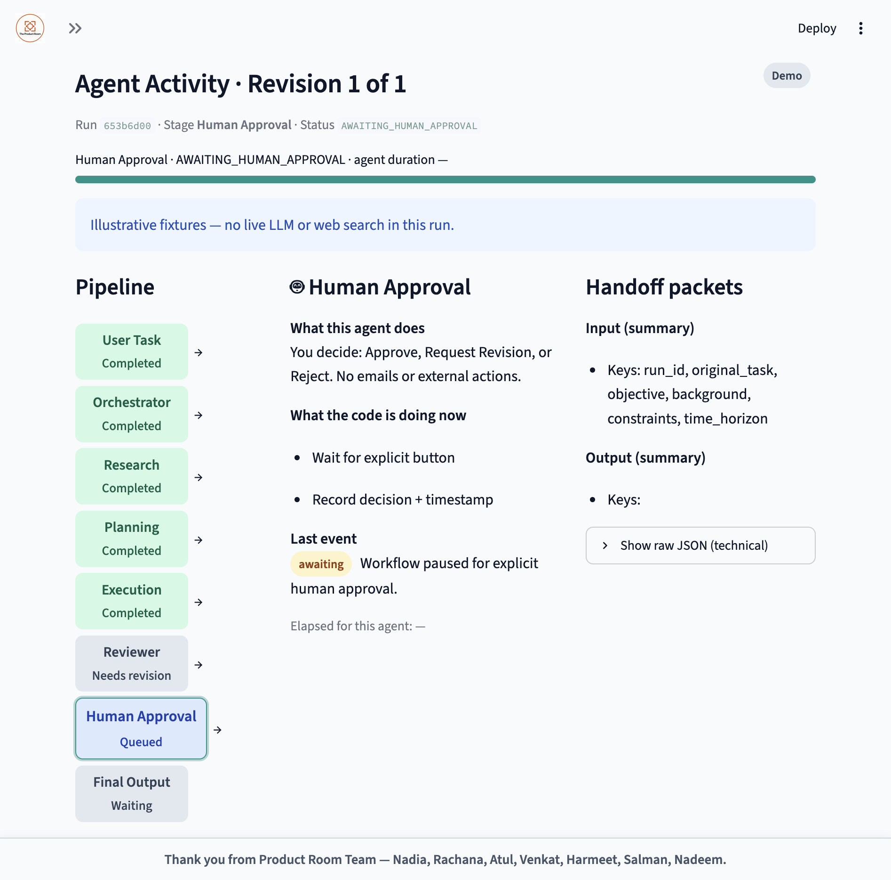
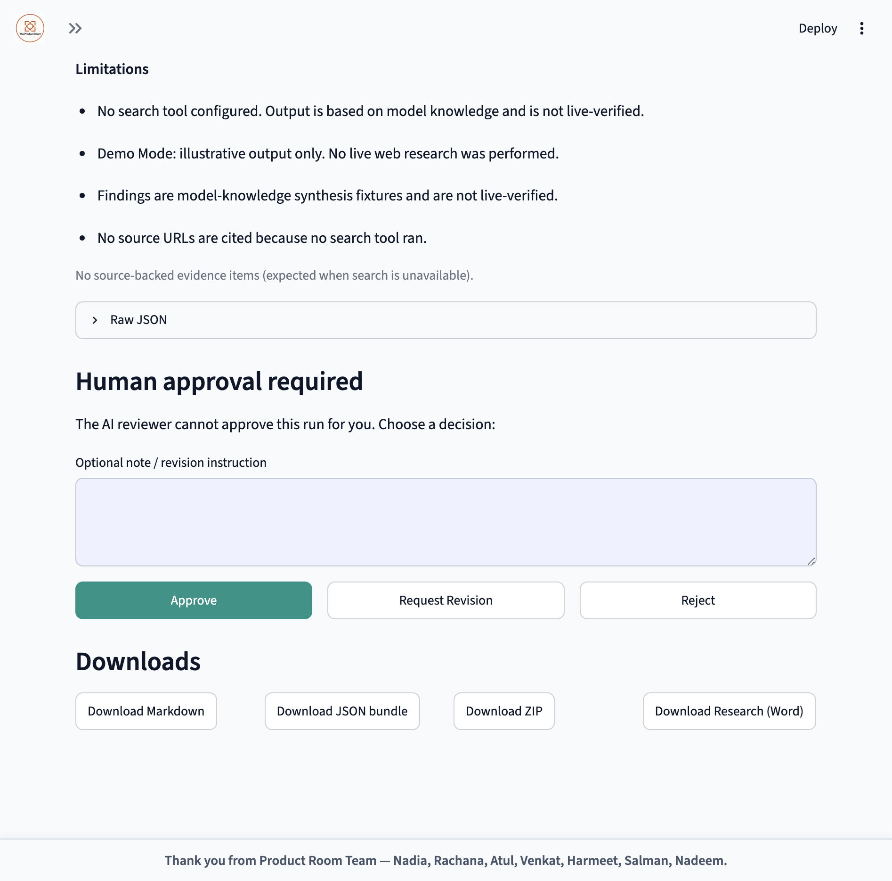
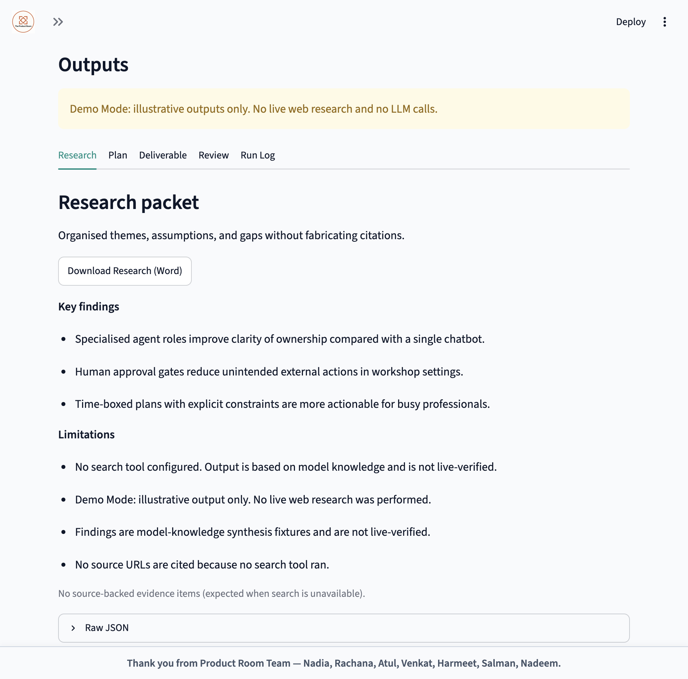

# Personal AI Workforce Studio — Landing Guide



**From AI Assistant to Agentic AI That Gets Work Done**

Personal AI Workforce Studio is a Streamlit workshop app that shows how a coordinated team of specialised AI agents can research, plan, create, and challenge work — then pause for **your** approval. You submit a plain-language task; the Orchestrator and four specialists run in a visible pipeline; nothing consequential happens outside the app until you decide.

**Demo Mode** works offline with no API keys.

---

## What you get

- **Two execution modes** — Demo (deterministic fixtures, no network) and Live LLM (your configured provider via LiteLLM).
- **Task workspace** — Type an objective, load a sample, or load a saved template from Task Manager.
- **Run Workforce** — Starts the pipeline: Orchestrator → Research → Planning → Execution → Reviewer → Human Approval.
- **Opt-in auto-approve** — Session checkbox (off by default) to approve a clean finished run without an extra click; still recorded as a human-origin decision in the feed.
- **Pause / Start** — Pause after the current stage; Start resumes the same run when status is paused.
- **Agent Activity overlay** — Focused view of which agent is running, what it does, and handoff summaries.
- **Pipeline, activity feed, and agent inspector** — Status text, events, and input/output packets per agent.
- **Output tabs** — Research, Plan, Deliverable, Review, Run Log (plus raw JSON expanders for technical attendees).
- **Mandatory human gate** — Approve, Request Revision, or Reject. The Reviewer never marks a run human-approved.
- **Downloads** — Markdown briefing, JSON bundle, ZIP, and Research as Word (`.docx`).
- **Task Manager** — Create, update, and delete reusable task templates.
- **Run History** — Reopen past runs from local SQLite (when persistence is enabled).
- **Agent Lab** — Inspect and session-override agent system prompts.
- **About & Setup** — Provider readiness, safety notes, workshop metrics.

**Safety boundary:** the app does not send emails, change calendars, make purchases, or take other external side effects. It produces drafts and recommendations for human review.

---

## Pages at a glance

| Page | What it is for |
| --- | --- |
| **Workforce Studio** | Primary workshop screen: mode, task form, run, overlay, outputs, approval, downloads |
| **Task Manager** | Browse system samples; create / edit / delete your saved templates |
| **Run History** | List and reopen persisted runs; clear local DB if needed |
| **Agent Lab** | Read default prompts; apply session-only overrides for experiments |
| **About & Setup** | Product summary, provider status, safety, local metrics |

The app entry point (`app.py`) is this landing page. Use **Open Workforce Studio** (or the sidebar) to enter the primary workshop screen.

---

## Workshop walkthrough

1. Open the app (local URL from `streamlit run app.py`, typically http://localhost:8501).
2. Choose **Demo Mode** (default) or configure credentials and select **Live LLM Mode**.
3. Load a sample or saved task, or type your own objective. Optionally expand context, constraints, time horizon, and output format.
4. Click **Run Workforce**. Watch the Agent Activity overlay and pipeline update as each stage completes.
5. Inspect Research / Plan / Deliverable / Review tabs and the agent inspector.
6. At **Human approval required**, choose **Approve**, **Request Revision** (needs a short instruction), or **Reject**.
7. Download the outputs you need.
8. Use **New Task** to clear the form, **Task Manager** to save templates, and **Run History** to reopen earlier runs.

---

## User flowchart



**Notes**

- Reviewer may request one bounded automatic revision before the human gate (default max revisions = 1).
- Human **Request Revision** re-enters the workflow with your instruction.
- Live Mode is blocked with a clear error if credentials are missing — the app never silently falls back to Demo Mode.

---

## Product Screenshots

If a capture is missing, the caption describes what you should see on that screen.

### 1. Workforce Studio — task workspace



*Mode selector, task / objective field, sample or saved-task picker, and **Run Workforce** / **New Task** / **Reset**.*

### 2. Agent Activity / pipeline



*While or after a run: Agent Activity overlay or Workforce overview with pipeline chips, activity feed, and current stage.*

### 3. Human approval



*When status is awaiting human approval: Approve, Request Revision, and Reject — reviewer approval is not enough on its own.*

### 4. Outputs and downloads



*Research / Plan / Deliverable / Review tabs and download buttons for Markdown, JSON, ZIP, and Research Word.*

---

## FAQ

### What is the difference between Demo Mode and Live Mode?

**Demo Mode** uses built-in illustrative fixtures. No API key and no live model or search calls. **Live LLM Mode** sends your task context to the configured model (default `openai/gpt-4o-mini` via LiteLLM). Live Mode requires provider credentials.

### Do I need an API key to try the workshop?

No. Start in Demo Mode. Add `OPENAI_API_KEY` (or the matching provider key) only when you want Live Mode.

### Does the Reviewer approve the work for me?

No. The Reviewer scores quality and may request a bounded revision. **You** must Approve, Request Revision, or Reject. Reviewer “approved” never sets the run to human-approved.

### Can this app send email, update my calendar, or buy something?

No. The MVP has no external side effects. Outputs are drafts for your review and download.

### Where are runs and tasks saved?

When persistence is enabled, runs go to local SQLite under `data/` (e.g. `data/workforce.db`). Saved task templates are JSON files under `data/tasks/`. On Streamlit Community Cloud, `data/` can reset on redeploy — fine for workshops, not durable storage.

### What is Task Manager vs Workforce Studio?

**Task Manager** stores reusable templates. **Workforce Studio** is where you run the workforce. Load a saved or sample task into the Studio form, then click Run Workforce.

### How do I clear a run or start over?

Use **New Task** to clear the form and current run state, or **Reset** (with confirm if a run is active / awaiting approval). Run History can clear the local database if needed.

### What is the revision limit?

By default the app allows one automatic reviewer-driven revision (`WORKFORCE_MAX_REVISIONS`). After that, the run pauses for your human decision even if the reviewer still wants changes.

### Is live web search required?

No. Optional Firecrawl search uses `FIRECRAWL_API_KEY`. Without it, Live research is labelled as model knowledge / not live-verified and must not invent fake URLs. Demo Mode never implies live web research.

### Can I change agent prompts?

Yes, on **Agent Lab** — edits apply to the current Streamlit session only and are not written as secrets or permanent config.

### The page feels frozen while agents run. Is that expected?

Streamlit still processes the run in the page script. Use the Agent Activity overlay to follow progress. **Pause** stops after the current stage; **Start** resumes. Schedule-for-later is covered as a design note in [`enhancement.md`](enhancement.md), not as a guaranteed UI control.

---

## Planned UX (design notes)

[`enhancement.md`](enhancement.md) is the design write-up for workshop UX. Some ideas there (auto-approve, Pause / Start, in-app notices) may already appear in Workforce Studio; treat the markdown as the design reference, and the running app as source of truth.

Still design-oriented / not assumed shipped everywhere:

- **Schedule or Run now** — pick a future time; start when due only while Workforce Studio is open (see enhancement.md §7)

Related: [`UIenhancement.md`](UIenhancement.md) documents the Agent Activity overlay.

---

## Quick start

```bash
/opt/homebrew/bin/python3.12 -m venv .venv
source .venv/bin/activate          # Windows: .venv\Scripts\activate
pip install -r requirements.txt
cp .env.example .env
streamlit run app.py
```

Open the URL Streamlit prints (typically http://localhost:8501). Deploy on [Streamlit Community Cloud](https://share.streamlit.io) with main file `app.py` if you want a shared workshop URL — see [`README.md`](README.md) for secrets and limits.

---

## More reading

| Document | Contents |
| --- | --- |
| [`README.md`](README.md) | Setup, modes, workshop flow, troubleshooting |
| [`ARCHITECTURE.md`](ARCHITECTURE.md) | Technical layout |
| [`Personal_AI_Workforce_Studio_PRD.md`](Personal_AI_Workforce_Studio_PRD.md) | Full product requirements |
| [`enhancement.md`](enhancement.md) | Planned UX enhancements (design only) |

---

*Document type: workshop landing guide (Markdown only). No application code ships with this file.*
