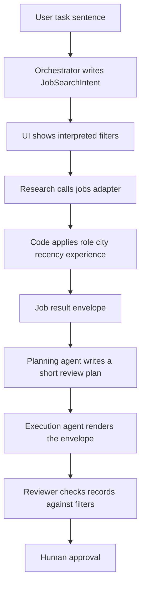
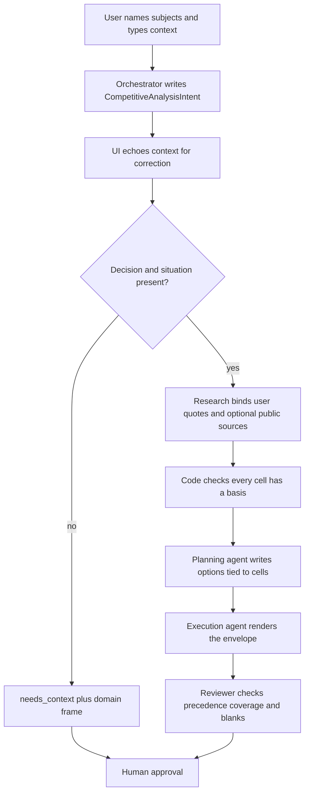

# Real Use-Case Enhancement — Job Search and Competitive Analysis

**Product:** Personal AI Workforce Studio  
**Document type:** Research and technical design (design only)  
**Status:** Research only — no application code ships with this file  
**Date:** 14 November 2026; competitive analysis added 15 November 2026  
**Example use cases:**

1. “Find product manager jobs in Hyderabad, 5–10 years of experience, posted in the last 7 days.”
2. “Compare product manager and product marketer for my situation.” The user supplies the context (company, market, decision, constraints).

**Required result shapes:**

1. Job records with job id, job description, and company name, plus the filters the app actually applied.
2. A comparison envelope: echoed user context, named subjects, shared criteria, one cell per subject per criterion, evidence basis on every cell, and an explicit decision implication. Unknown cells stay empty.

This file does not change Python, tests, prompts, styles, or configuration. It records how the current workforce behaves on these tasks, why a longer prompt will not fix them, and how a later build should turn each sentence into a typed intent and a typed result set.

---

## 1. Decision this research supports

The workshop app should keep the same agent order and the same human gate. What has to change is the **unit of work**.

Today every task becomes a generic briefing: themes, a weekly plan, and markdown. Two real requests need their own units:

- A **hiring search** asks the workforce to interpret filters, retrieve listings, and return job records. Each included row must carry a source job id, the employer name, and the description text the source actually returned. Rows the model cannot ground in a retrieved listing must not appear. Sections 2–11 specify that unit.
- A **competitive analysis** asks the workforce to compare subjects the user names, inside a situation the user describes. The worked example is Product Manager versus Product Marketer. The useful output is a comparison matrix whose cells cite the user’s context or a retrieved source. A textbook essay that ignores the company, market, and decision the user wrote is the wrong unit. Sections 17–26 specify that unit.

---

## 2. The target request, stated precisely

### 2.1 User words

> Create a task: product manager jobs in Hyderabad, with 5–10 years of experience, posted in the last 7 days.

### 2.2 What a correct system must extract

| Slot | Value the app should commit to | What must not be guessed |
| --- | --- | --- |
| Domain | Job search | Do not treat this as a career-advice or “how to become a PM” essay |
| Role family | Product manager | Do not silently expand into project manager, product marketing, or product design |
| Place | Hyderabad, India | Do not treat “Hyderabad” as a keyword that can match a company description or a different Hyderabad |
| Experience | Inclusive band, 5 to 10 years | Do not map this to “senior” only, and do not drop the band because an API lacks the field |
| Recency | Posted on or after today minus 7 days | Do not use the date a web page was indexed as if it were `datePosted` |
| Deliverable | A table of job records | Do not collapse the answer into three bullet “themes” |

### 2.3 What “understand the domain” means here

Domain understanding is a **typed interpretation**, checked before any search runs. It has four parts:

1. **Task class.** This request is `job_search`. The three built-in samples (plan a week, product opportunity brief, learning roadmap) are `briefing`. The class chooses the schema, the retrieval tool, and the reviewer checks.
2. **Role family.** “Product manager” is a function with near titles and hard exclusions (section 6).
3. **Hard filters.** Location, experience band, and posted-within window are constraints. A listing that fails one of them is excluded or marked unmatched. It is not “close enough” prose.
4. **Record contract.** Every included job has a source identity, an employer, a description, a location, a posted time, and an experience reading. Missing fields stay null and lower the match status. They are never filled in by the model.

If any of those four is missing, the app has not understood the domain. It has paraphrased the sentence.

---

## 3. How this request runs in the code today

The trace below uses the files as they are. No new behaviour is assumed.

### 3.1 Intake is free text

[`TaskInput`](src/models/task.py) stores five strings: `task`, `background`, `constraints`, `time_horizon`, `output_format`. There is no role, city, experience minimum, experience maximum, or recency field.

[`validate_task_input`](src/config/validation.py) trims whitespace and enforces a length cap (`WORKFORCE_MAX_TASK_LENGTH`, default 4000). It does not parse “5–10 years” or “last 7 days”.

Saved tasks in [`TaskRepository`](src/persistence/task_repository.py) persist the same flat fields. A saved “PM jobs in Hyderabad” template cannot store the interpreted filters separately from the sentence.

The only samples in [`src/config/samples.py`](src/config/samples.py) are:

- Plan my next productive week.
- Research a product opportunity and prepare a brief.
- Create a learning roadmap for a new skill.

None of them is a lookup with filters.

### 3.2 The orchestrator writes a generic specification

[`specify_node`](src/orchestration/nodes.py) asks the model for a `TaskSpec`, then falls back to [`build_task_spec`](src/demo/fixtures.py). Success criteria are always the same four lines: address the objective, produce a readable deliverable, separate evidence from assumptions, leave approval to the human.

Nothing in `TaskSpec` says “return job records” or “exclude listings older than 7 days”. Later agents only see that generic contract. The reviewer in [`src/agents/reviewer_agent.py`](src/agents/reviewer_agent.py) scores against those criteria, so a fluent essay about the Hyderabad PM market can pass even when it contains zero jobs.

### 3.3 Research issues one undifferentiated web query

[`ResearchAgent.build_user_prompt`](src/agents/research_agent.py) calls search like this:

- Query text = `task.objective` (the whole sentence, truncated to 120 characters in the demo spec builder).
- `max_results = 5`.
- No location, no country, no time filter, no site filter, no second query for title variants.

[`FirecrawlSearchProvider.search`](src/providers/firecrawl_search.py) posts only `{"query": query, "limit": max_results}` to `https://api.firecrawl.dev/v2/search`. The Firecrawl API itself accepts `location`, `country`, and `tbs` (for example `qdr:w` for the past week, documented at [Firecrawl search](https://docs.firecrawl.dev/features/search)). This adapter does not send them.

Returned items are title, URL, domain, and a snippet capped at 500 characters. There is no job id, employer, posted date, or experience range on [`SearchResult`](src/providers/search_base.py).

If Firecrawl is not configured, research is labelled model knowledge and evidence URLs are stripped. That rule is correct. It also means Live Mode without a search key cannot return real Hyderabad openings, and Demo Mode must not pretend it did.

### 3.4 Evidence cannot hold a job

[`EvidenceItem`](src/models/research.py) is a claim plus an optional URL. [`ResearchPacket`](src/models/research.py) is findings, assumptions, risks, and open questions. There is nowhere to put:

- `job_id`
- `company_name`
- `job_description`
- `experience_min` / `experience_max`
- `date_posted`
- `match_status`

A model that tries to stuff “Job 12345 at Acme, 6–9 years” into `key_findings` produces an untyped string. The UI in [`render_output_tabs`](src/ui/output_views.py) prints those strings as bullets. The Deliverable tab renders `markdown_content`. There is no jobs table.

### 3.5 Planning and execution assume a personal action plan

[`Plan`](src/models/plan.py) is priorities, actions, and a day-by-day timeline. [`Deliverable`](src/models/deliverable.py) is an executive summary, recommendations, and markdown. The execution prompt in [`src/config/prompts.py`](src/config/prompts.py) says “create the requested deliverable” and “do not introduce unsupported facts”. It never says “emit one object per retrieved job and copy ids from the tool payload”.

Demo fixtures in [`src/demo/fixtures.py`](src/demo/fixtures.py) ignore the user’s topic. `build_research_packet` always returns findings about agent ownership and human approval gates, with `evidence_items: []`. A demo run of the Hyderabad task would show a productivity briefing and a limitation that no live research ran. That limitation is honest. It is also proof that Demo Mode is not yet a realistic job-search walkthrough.

### 3.6 What the user would actually see

| Step | Current result for the example |
| --- | --- |
| Task form | One text box. “5–10 years” and “last 7 days” are not fields. |
| Specification | Objective text plus generic success criteria. |
| Research | Up to five web snippets, or an explicit “not live-verified” packet. |
| Plan | A generic action list (frame the work, block focus time, draft, review). |
| Deliverable | A markdown brief. Job id, employer, and description are not columns. |
| Review | Can approve the brief because the brief “addresses the objective” in prose. |
| Human gate | Still required. That part should stay. |

The safety rules that already exist should stay with this enhancement: no fabricated URLs ([`ResearchAgent.run`](src/agents/research_agent.py) drops URLs that were not in the tool result), no external side effects (the app must not apply to jobs, email recruiters, or change a calendar), and reviewer approval is not human approval ([ARCHITECTURE.md](ARCHITECTURE.md)).

---

## 4. Why prompting the same schemas harder will fail

Three failure modes show up as soon as the sentence is realistic.

**The model invents listings.** Job ids, company names, and descriptions are exactly the fields a language model will fill when the schema is prose. The current URL allow-list stops fake links. It does not stop a fake employer name inside `key_findings` or `markdown_content`.

**The filters are not executable.** “Last 7 days” inside a prompt is a wish. Firecrawl’s `tbs=qdr:w` filters the **index date of a web result**, not the job’s `datePosted`. A 2024 article titled “Product Manager jobs in Hyderabad” can be re-crawled this week and look fresh. Experience is worse: most search snippets never state “6–9 years” in the first 500 characters, so the model either drops the filter or guesses.

**One query is the wrong role family.** The sentence “product manager jobs in Hyderabad” also matches:

- Project Manager and Program Manager
- Product Marketing Manager
- Production Manager and Product Support
- “Jobs in Hyderabad” roundup pages that are not a single posting
- Company blog posts and salary articles

A single `what=product manager` string without a title policy and an exclude list will not “understand the domain”. It will retrieve the neighbourhood of the words.

The fix is a **query object** in front of retrieval and a **job record** behind it. The model may propose the query object. Code validates it. The model may summarise the records. Code decides which records are included.

---

## 5. Intent object

Parse the task once, during specification, into a `JobSearchIntent`. Keep the original sentence. Do not make the user fill a ten-field form before the workshop can run, but do show the interpreted filters and let the user correct them before Run Workforce.

```json
{
  "task_class": "job_search",
  "role_query": "product manager",
  "role_family": "product_management",
  "title_include": [
    "product manager",
    "senior product manager",
    "lead product manager",
    "group product manager",
    "principal product manager",
    "product owner",
    "technical product manager"
  ],
  "title_exclude": [
    "project manager",
    "program manager",
    "product marketing",
    "product designer",
    "production manager",
    "product support",
    "product analyst"
  ],
  "location": {
    "city": "Hyderabad",
    "region": "Telangana",
    "country_code": "IN",
    "aliases": ["hyderabad", "hyd", "cyberabad", "hitec city", "gachibowli", "madhapur", "kondapur"],
    "radius_km": 40,
    "accept_remote": false
  },
  "experience": {
    "min_years": 5,
    "max_years": 10,
    "range_policy": "overlap"
  },
  "posted_within_days": 7,
  "employment_type": null,
  "workplace": null,
  "limit": 20,
  "unparsed_remainder": ""
}
```

### 5.1 Parsing rules

- Numbers win over adjectives. “5–10 years” sets `min_years=5` and `max_years=10`. Words like “senior” do not override the numbers.
- “Last 7 days”, “past week”, and “posted this week” set `posted_within_days=7`. “Last 7 days” is a rolling window ending at retrieval time, stored as `retrieved_at` and `posted_after` in UTC.
- City names map through a small alias table. Hyderabad in Telangana is the default when the rest of the query is an Indian job search. If the text also says “Hyderabad, Sindh” or another country, the country on the intent wins and the run should show that choice.
- `accept_remote` stays false unless the user said remote, hybrid, or work-from-home. A pan-India remote posting is a separate bucket, not a Hyderabad match.
- If the sentence has a hiring ask but a slot is missing, the spec lists it under `open_filters` (for example experience not stated). The run may continue only for the slots that are present, and the result header must say which filter was not applied.
- `unparsed_remainder` catches industry words the lexicon does not own (“fintech”, “payments”, “B2B SaaS”). Those become extra keywords, not silent drops.

### 5.2 Range policy for 5–10 years

Job ads publish a range, not a point. Use **overlap**, and show it:

| Posting says | Result |
| --- | --- |
| 6–9 years | `exact` — the posting range sits inside 5–10 |
| 4–7 years | `overlap` — intersects 5–10; include, labelled overlap |
| 8–12 years | `overlap` — intersects 5–10; include, labelled overlap |
| 2–4 years | `exclude` — no overlap |
| 12–15 years | `exclude` — no overlap |
| “Senior product manager” and no years | `unknown_experience` — do not treat the title as 5–10; keep only in an “experience not stated” section |
| 5–10 in the snippet but the structured field disagrees | Prefer the structured field; mention the conflict |

A posting included as `exact` or `overlap` can appear in the main table. `unknown_experience` must not be mixed into that table without a label. This is the behaviour that makes the experience filter real.

Adzuna’s public search API has `max_days_old` and `where`, and it does **not** have a 5–10 year parameter (see section 8). Experience for that source is a post-filter on text, with status `unknown_experience` when the text is silent. The Intelligence API’s `years_of_experience` dimension uses coarse buckets (`3_5_years`, `6_8_years`, `9_years_and_more`), which cannot express 5–10 exactly. Do not pretend a bucket filter is the user’s band.

---

## 6. Product-manager role family

“Understand the domain” for this example means applying a title policy before ranking prose.

### 6.1 Include

These titles are the same function at the requested seniority. For 5–10 years, Associate Product Manager and VP Product are weak includes: show them only if the experience field overlaps 5–10.

| Canonical title | Also accept |
| --- | --- |
| Product Manager | PM (only as a whole token), Product Mgr |
| Senior Product Manager | Sr Product Manager, Sr. PM |
| Lead Product Manager | Product Lead |
| Group Product Manager | GPM |
| Principal Product Manager | Staff Product Manager |
| Technical Product Manager | TPM when the posting is product, not program |
| Product Owner | PO, when the description is product ownership rather than scrum administration |

Industry prefixes stay inside the family: “Product Manager, Payments”, “B2B SaaS Product Manager”, “Product Manager – Platform”. The industry goes to `specialisation`, not to a different role family. The user did not name an industry, so specialisation is a facet for grouping, not a filter.

### 6.2 Exclude, even if the page is in Hyderabad and recent

| Lookalike | Why it is out of family |
| --- | --- |
| Project Manager, Program Manager | Delivery management, not product discovery and roadmap ownership |
| Product Marketing Manager, PMM | Go-to-market, not the product role |
| Product Designer, UX | Design |
| Production Manager | Manufacturing or operations |
| Product Support, Product Analyst | Support or analytics unless the title also says Product Manager |
| Category Manager, Brand Manager | Commercial management, unless the user asked for it |
| Engineering Manager | People management for engineering |

“Technical Program Manager” is excluded. “Technical Product Manager” is included. The token difference is the domain rule.

### 6.3 What this family is not

The app should not invent a Hyderabad market essay: salary bands, “top companies hiring PMs”, or “skills you need”. Those are briefing tasks. If the user asks for jobs, the primary object is the listing. A short note on coverage (“how many rows, how many dropped, which source”) is part of the result header, not a substitute for rows.

---

## 7. Location and recency semantics

### 7.1 Hyderabad

Treat the workplace city as the match field, not the query string.

- Match: `job_city` or the source location display contains Hyderabad or a listed locality (HITEC City, Gachibowli, Madhapur, Kondapur, Financial District, Nanakramguda).
- Match as `metro_alias` only when the source city is “Hyderabad, Telangana” written another way (Hyd, Cyberabad).
- Do not match: the employer’s headquarters text mentions Hyderabad but `job_city` is Bengaluru; a news article about Hyderabad; a job in Hyderabad, Sindh, when the intent country is IN.
- Remote: if the user did not ask for remote, put India-remote rows in `excluded_or_unmatched` with reason `remote_not_requested`.
- Radius: Adzuna’s `where` search defaults to **5 km** from the resolved centre ([Adzuna search parameters](https://developer.adzuna.com/docs/search)). A 5 km radius around a geocoded “Hyderabad” point will miss many HITEC City and Gachibowli postings. For a city-level ask, set `distance` to about 40 km and then still require the city alias. Record the radius on the query echo so the user can see it.

### 7.2 Last 7 days

Compute `posted_after = retrieved_at - 7 days` once per run and store both timestamps on the result set.

- Include when `date_posted >= posted_after`.
- Exclude when `date_posted` is older.
- If the source has only a relative label (“3 days ago”), convert it using `retrieved_at` and keep the original label.
- If the source has no posted date, status is `unknown_recency` and the row does not enter the main table.

Do not use Firecrawl `tbs` as proof of `datePosted`. `tbs` may be used as a **retrieval hint** to avoid ancient pages. The include decision uses the job’s own posted timestamp.

---

## 8. Where job records can actually come from

The current search tool returns web pages. A job record has to come from a source that already has an id, an employer, and a description. Options below are research inputs for a later adapter. They are not a recommendation to scrape sites that forbid automation.

### 8.1 Comparison

| Source | Structured id, company, description | Location filter | Recency filter | Experience filter | Fit for this example | Constraint |
| --- | --- | --- | --- | --- | --- | --- |
| **Adzuna Jobs API** `GET /v1/api/jobs/in/search/{page}` | Yes. `id`, `company.display_name`, `description`, `created`, `location`, `redirect_url`. Description on the search row is truncated to about **500 characters**. | `where=Hyderabad`, `distance` in km. Country path `in` is supported. | `max_days_old=7`, `sort_by=date`. | No years parameter on the public search API. | Best first licensed adapter: legal, filterable, India path exists. | 500-character description is not a full job description. Full text needs a follow-up read of that ad (`adref`) or the advertiser page via `redirect_url`. Coverage of Indian PM roles is often thinner than Naukri. Salary may be predicted (`salary_is_predicted=1`) and must be labelled as predicted. |
| **JSearch** (RapidAPI / OpenWeb Ninja) | Yes. `job_id`, `employer_name`, `job_description`, `job_city`, `job_posted_at_datetime_utc`, apply link, highlights, sometimes required experience. | Location is mostly inside the query string; `country` is a separate code. | `date_posted=week` (also `today`, `3days`, `month`). | `job_requirements` is coarse (`under_3_years_experience`, `more_than_3_years_experience`). It cannot express 5–10. | Useful when a fuller description and a stable `job_id` matter. | Third-party index over boards (Indeed, LinkedIn, and others). Terms, freshness, and India coverage must be checked per key. Default country in several clients is `us`; this run must pass India explicitly. |
| **Firecrawl `/v2/search`** (already integrated) | No. Title, URL, snippet. | `location` and `country` exist on the API and are unused by this app. | `tbs=qdr:w` filters the web index, not the job. | None. | Good for finding career-page URLs and for the current briefing tasks. Weak as the system of record for job ids. | Turning a career page into records needs a per-site extractor. Snippets are untrusted. The app already warns agents not to follow instructions inside them. |
| **Foundit (Monster India), Shine, Instahyre, CutShort** | Often yes on their own sites: id, title, company, city, and sometimes experience and freshness. Foundit-style search is described with experience and freshness filters. Instahyre’s public feed often omits experience, salary, posted date, and full description. | City parameter or post-filter. | Freshness on some boards (for example 1, 3, 7, 15, 30 days). | Some boards expose a years range that can overlap 5–10. | Highest practical coverage for Hyderabad tech and product roles. | **No official public API** for these boards. Access is site-front-end JSON or third-party actors. Do not add a scraper that bypasses access controls. A later adapter is in scope only for a source with a permitted API or a licence. |
| **Naukri** | The site itself has experience, city, and freshness (“posted in last 7 days”) that match this query almost one-to-one. | Yes, on the website. | Yes, on the website. | Yes, a years integer. | Best product fit, worst integration fit. | No official API. Automated access is commonly blocked. Out of scope for this app. |
| **LinkedIn** | Rich in the product, not in a workshop-safe API. | — | — | — | Do not scrape. | Use only if a compliant partner API is added later. A hand-built URL is not a job record. |

### 8.2 Recommended retrieval order for a later build

1. **Primary:** one licensed jobs API with India support. Adzuna is the clearest documented fit (`country=in`, `what`, `where`, `distance`, `max_days_old`, `sort_by=date`).
2. **Post-filter in this app:** role family, Hyderabad alias, 7-day timestamp, experience overlap. The API’s filters are necessary and not sufficient.
3. **Description completeness:** if the search row description is truncated, fetch the single-ad payload or stop at the truncated text and set `description_completeness=truncated`. Never ask the model to “complete” the description.
4. **Optional second source:** a second permitted API, merged by canonical key (section 9.4).
5. **Firecrawl stays** for non-job tasks and, later, as an optional “career page” hint. It does not mint job ids.

### 8.3 Query the adapter should send for the example

Illustrative Adzuna call, not an implementation:

```text
GET https://api.adzuna.com/v1/api/jobs/in/search/1
  ?what=product%20manager
  &where=Hyderabad
  &distance=40
  &max_days_old=7
  &sort_by=date
  &sort_dir=down
  &results_per_page=50
  &content-type=application/json
```

Title policy and the 5–10 year overlap run **after** this response. `what_exclude` can drop the worst lookalikes (`project`, `marketing`) but will also drop legitimate “product marketing” collisions inside a true product-manager ad, so exclusions should be title-based in code, not only keyword-based in the API.

Illustrative JSearch call:

```text
GET /search
  ?query=product%20manager%20jobs%20in%20Hyderabad
  &country=in
  &date_posted=week
  &num_pages=2
```

Then the same post-filter. `date_posted=week` is “about 7 days”, not a timestamp. Re-check `job_posted_at_datetime_utc` against `posted_after`.

---

## 9. Canonical job record

This is the object the user asked for. Field names stay stable even when the source changes.

### 9.1 Record

| Field | Required in the main table | Rule |
| --- | --- | --- |
| `job_id` | Yes | Source id, copied verbatim. Prefix with source when merging: `adzuna:51298321`. The model must not generate this. |
| `source` | Yes | `adzuna`, `jsearch`, or another permitted adapter name. |
| `source_job_id` | Yes | Raw id before prefixing. |
| `title` | Yes | Source title. Do not rewrite it. |
| `company_name` | Yes | Employer display name. `null` is allowed only in the unmatched bucket, with reason `missing_company`. Anonymous ads use the source’s own label (for example “Confidential”), not a guessed brand. |
| `job_description` | Yes | Source text only. HTML stripped to text. If the API truncated it, say so in `description_completeness`. Do not paraphrase into this field. |
| `description_completeness` | Yes | `full` or `truncated`. |
| `location_text` | Yes | Source location string. |
| `city` | Yes for a Hyderabad match | Normalised city. |
| `country_code` | Yes | `IN` for this example. |
| `date_posted` | Yes | ISO-8601 from the source, or null. |
| `posted_label` | No | Original relative text if that is all the source gave. |
| `experience_text` | No | Raw phrase, e.g. “6-9 years”. |
| `experience_min` | No | Integer years if parsed from a structured field or a clear pattern. |
| `experience_max` | No | Integer years. Open-ended “8+” sets min=8 and max=null. |
| `experience_match` | Yes | `exact`, `overlap`, `unknown`, `exclude`. |
| `role_match` | Yes | `in_family` or `out_of_family`. |
| `location_match` | Yes | `city`, `locality_alias`, `mismatch`, `unknown`. |
| `recency_match` | Yes | `within_window`, `stale`, `unknown`. |
| `match_status` | Yes | `included` only when role, location, and recency pass and experience is `exact` or `overlap`. |
| `match_reasons` | Yes | Short machine reasons, safe to show in the UI. |
| `employment_type` | No | Source value; null if absent. |
| `workplace` | No | `onsite`, `hybrid`, `remote`, or `unknown`. |
| `salary_min`, `salary_max`, `salary_currency` | No | Only if the source provided them. |
| `salary_is_predicted` | No | True when the source estimated pay. Predicted pay is not an employer offer. |
| `apply_url` | Yes when the source gave one | Must be a URL returned by the tool. Same allow-list rule as research URLs today. |
| `retrieved_at` | Yes | UTC timestamp of this run’s fetch. |

### 9.2 Result envelope

The deliverable for `task_class=job_search` is this envelope. Markdown is a rendering of it, not the source of truth.

```json
{
  "task_class": "job_search",
  "query_echo": {
    "original_task": "Product manager jobs in Hyderabad, 5-10 years experience, posted in the last 7 days.",
    "role_family": "product_management",
    "location_label": "Hyderabad, Telangana, IN",
    "radius_km": 40,
    "experience_min": 5,
    "experience_max": 10,
    "experience_policy": "overlap",
    "posted_within_days": 7,
    "posted_after": "2026-11-07T10:30:00+00:00",
    "retrieved_at": "2026-11-14T10:30:00+00:00",
    "sources_queried": ["adzuna"],
    "sources_failed": []
  },
  "summary": {
    "included_count": 2,
    "excluded_count": 3,
    "unknown_experience_count": 1,
    "notes": [
      "Adzuna search descriptions are truncated to 500 characters.",
      "Experience was applied after retrieval because the source has no 5-10 year parameter."
    ]
  },
  "jobs": [],
  "needs_review": [],
  "excluded": []
}
```

`jobs` holds `match_status=included`. `needs_review` holds in-family, in-city, in-window rows whose experience is unknown. `excluded` holds the rest, each with a reason code. The UI shows counts for all three so an empty main table is explained (“12 retrieved, 12 excluded: 7 wrong role, 3 stale, 2 wrong city”) instead of looking like a crash.

### 9.3 Illustrative included row

Values below are **shape examples**, not live openings. A real run must replace every identifier, employer, description, and URL with tool output.

```json
{
  "job_id": "adzuna:example-id",
  "source": "adzuna",
  "source_job_id": "example-id",
  "title": "Senior Product Manager",
  "company_name": "Example Software Pvt Ltd",
  "job_description": "Source description text copied from the API, not written by the model.",
  "description_completeness": "truncated",
  "location_text": "Hyderabad, Telangana",
  "city": "Hyderabad",
  "country_code": "IN",
  "date_posted": "2026-11-12T06:15:00Z",
  "experience_text": "6-9 years",
  "experience_min": 6,
  "experience_max": 9,
  "experience_match": "exact",
  "role_match": "in_family",
  "location_match": "city",
  "recency_match": "within_window",
  "match_status": "included",
  "match_reasons": [
    "title in product_management family",
    "city Hyderabad",
    "posted 2026-11-12 within 7 days of 2026-11-14",
    "experience 6-9 overlaps 5-10 as exact"
  ],
  "salary_is_predicted": false,
  "apply_url": "https://www.adzuna.in/land/ad/example-id",
  "retrieved_at": "2026-11-14T10:30:00+00:00"
}
```

### 9.4 Identity and duplicates

- Primary key: `source + source_job_id`.
- If two sources describe the same opening, keep both rows linked by `duplicate_of` when the apply URL host, company, and normalised title match. Do not silently discard the second id; the user asked for job ids, and ids are source-specific.
- Sort the included table by `date_posted` descending, then title.
- Cap the included table (proposal: 20) and report `truncated_by_limit` on the summary when more matches exist.

### 9.5 Experience parsing (deterministic)

Apply only to source text, after HTML is stripped:

- `6-9 years`, `6 – 9 yrs`, `6 to 9 years` → min 6, max 9
- `minimum 5 years`, `at least 5 years` → min 5, max null (overlap if min ≤ 10)
- `8+ years` → min 8, max null
- `experience: 5-10` → min 5, max 10
- A bare “senior” with no number → leave min and max null, status `unknown`

If two different ranges appear, keep the one nearest the title or an “experience” heading and add a conflict note. Do not average them.

---

## 10. How the existing workforce should carry this

The LangGraph order stays: validate → specify → research → plan → execute → review → human gate. Responsibilities change when `task_class` is `job_search`.



### 10.1 Orchestrator

- Classify `job_search` versus `briefing`.
- Emit `JobSearchIntent` beside today’s `TaskSpec`.
- Success criteria become testable, for example:
  - Every included row has `job_id`, `company_name`, and `job_description` copied from a tool payload.
  - Every included row is in the product-management family.
  - Every included row is Hyderabad (or a listed locality) in India.
  - Every included row has `date_posted` on or after `posted_after`.
  - Every included row has experience overlap with 5–10, or it is not in the main table.
  - No apply URL that was absent from the tool response.
  - Empty included set is allowed and must explain exclusions.

### 10.2 Research

- Call the jobs adapter with the intent, not with the raw sentence alone.
- Map each API row into a canonical record in **code**, then ask the model to write `match_reasons` only from those fields.
- Drop any model-created job whose `job_id` is not in the tool payload. This is the same idea as today’s URL allow-list.
- Keep the current limitation string when no jobs adapter is configured. Do not fall back to invented listings. Firecrawl snippets may appear only as `coverage_notes`, never as jobs.
- Record `sources_failed` with a short safe error. A failed source is an empty contribution, not a reason to synthesise.

### 10.3 Planning

For this task class the plan is not a five-day calendar. It is a short decision plan:

- Which included rows match the band exactly.
- Which overlaps are borderline (4–7 or 8–12).
- Which in-family rows were held back because experience was missing.
- What the user still has to judge (specialisation, salary predicted versus disclosed, truncated descriptions).

Owners stay “user”. The plan must not say the workforce applied to a job.

### 10.4 Execution

- Render the envelope as the deliverable body: query echo, counts, included table, needs-review table, excluded reasons.
- `markdown_content` is a view of `jobs`. If they disagree, the structured `jobs` array wins and the reviewer flags the drift.
- Recommendations are limited to how to read the set (“three exact matches, two overlaps, descriptions truncated”). They are not new job rows.

### 10.5 Reviewer

Add criteria that can fail the run:

| Check | Fail when |
| --- | --- |
| Identity | An included row has an empty job id, empty company, or empty description |
| Grounding | A job id or apply URL is not in the research tool payload |
| Role | An included title is on the exclude list |
| Place | An included city is not Hyderabad or a listed locality |
| Recency | `date_posted` is null or older than `posted_after` |
| Experience | `experience_match` is `exclude` or `unknown` on an included row |
| Completeness | Summary counts do not equal the arrays |
| Safety | The text tells the user the run already applied, emailed, or scheduled an interview |

A fluent market summary with no rows fails “completeness” when the tool returned rows, and it fails “grounding” when it invented rows. An honest empty set with exclusion reasons can pass.

### 10.6 Human gate

Unchanged. The user still approves, rejects, or requests a revision. Approval means “this result set is the one I accept as the workshop output”. It does not submit applications.

### 10.7 Demo Mode

Add one labelled sample, for example “Find product manager jobs in Hyderabad (5–10 years, last 7 days)”. Demo fixtures should return two or three **illustrative** records with obvious fake ids (`demo-hyd-pm-1`), `source: "demo"`, and the existing demo disclaimer. Include one excluded row (project manager) and one needs-review row (no years stated) so the workshop shows the filter, not only the happy path.

Demo records must use `example.invalid` URLs or no URLs, and the UI must keep the “illustrative, not live openings” banner. Demo Mode must not imply a live search of Hyderabad.

---

## 11. Structured output on screen

The Deliverable tab for this task class should lead with the table, not with an essay.

**Query echo** (always visible): role family, Hyderabad + radius, 5–10 years (overlap), posted after `{date}`, source name, retrieval time.

**Included jobs**

| Job id | Title | Company | Location | Posted | Experience | Match | Description |
| --- | --- | --- | --- | --- | --- | --- | --- |
| Source id | Source title | Source company | City | ISO date | 6–9 exact | included | First ~400 characters, expand for the rest |

**Needs review** and **Excluded** sit below, grouped by reason code (`out_of_family`, `wrong_city`, `stale`, `unknown_experience`, `missing_company`).

Exports:

- JSON bundle already exists via [`ExportService`](src/services/export_service.py). The job envelope should be a first-class artifact in that bundle.
- Markdown export prints the same tables.
- CSV of the included rows is the format a hiring task actually wants (job id, title, company, city, date posted, experience, apply URL). Word export can remain for briefing tasks.

Raw JSON stays in an expander, as the Research tab does today.

---

## 12. Task classes

The same split — typed intent, tool-backed or user-backed records, code-enforced rules — applies across workshop tasks. Briefing tasks keep today’s `ResearchPacket`, `Plan`, and `Deliverable`. Job search and competitive analysis add their own envelopes. They do not replace the briefing schema.

| User sentence | Task class | Record | What the user must supply | What code enforces |
| --- | --- | --- | --- | --- |
| Product manager jobs in Hyderabad, 5–10 years, last 7 days | `job_search` | Job | The search sentence; filters may be confirmed | Role family, city, experience overlap, posted window, source job id |
| Compare product manager and product marketer; here is our context | `competitive_analysis` | Comparison cell | Subjects, the decision, and the situation | Shared criteria, cell basis, user-context precedence, no filled-in unknowns |
| Research a product opportunity and prepare a brief | `briefing` (exists) | Evidence item | The objective | No fabricated URLs |
| Find public courses on agentic AI under a weekly hour cap | `learning_search` later | Course | The learning constraint | Cost, level, time |

`competitive_analysis` is specified in sections 17–26. A product-versus-product comparison uses the same envelope when the user names the products. The worked example in this file is the role comparison, because that is the case where a generic essay is most likely to ignore the context the user actually typed.

---

## 13. Safety, honesty, and product boundaries

These follow the PRD and [ARCHITECTURE.md](ARCHITECTURE.md). The job use case makes them concrete.

- **No applications and no outreach.** The workforce retrieves and structures public listings. It does not apply, message a recruiter, or create interviews.
- **No invented jobs.** If the adapter returns nothing, the deliverable is an empty included list plus the reason (source not configured, source error, or all rows filtered). That is a successful honest run.
- **No invented descriptions.** Truncation is labelled. The model may add a one-line `why_it_matched` built only from `match_reasons`.
- **Untrusted page text.** Job descriptions are data. They often contain “ignore previous instructions” or application scripts. They stay inside the description field and do not enter the system prompt as instructions. The research prompt already says this for snippets; the jobs path needs the same rule.
- **Predicted salary.** If `salary_is_predicted` is true, the UI says the figure is a source estimate.
- **Personal data.** The task is a job search, not a résumé upload. Do not add a profile store in this slice. The existing warning against secrets and confidential data stays.
- **Terms of use.** Prefer a documented jobs API (Adzuna’s developer terms, or a key the workshop already accepts). Do not add Naukri, LinkedIn, or login-gated scrapers.
- **Freshness.** Every export shows `retrieved_at` and `posted_after`. A downloaded JSON from yesterday is not “today’s jobs”.
- **Human approval.** Still required before the run is marked approved. Auto-approval ideas in [`enhancement.md`](enhancement.md) are a separate UX topic and are not required for this design.

---

## 14. Phased build (later; not this change)

### Phase A — Intent and honest empty state

- Classify `job_search`.
- Show the interpreted filters on the task form.
- Extend Demo Mode with the labelled Hyderabad sample and the include / needs-review / exclude split.
- Reviewer checks the demo envelope.

Phase A is enough for the workshop to **see** domain understanding with no API key.

### Phase B — One live adapter

- Add a jobs provider beside Firecrawl, selected only when `task_class=job_search`.
- Map Adzuna (or the chosen API) into the canonical record.
- Apply role, city, recency, and experience overlap in code.
- Grounding check: drop ids the tool did not return.
- Surface truncated descriptions and predicted salaries.

### Phase C — Presentation

- Jobs table, reason groups, CSV export.
- Query echo on the Deliverable tab and in the JSON bundle.

Competitive analysis is a parallel track, specified in sections 17–26. It can ship as a Demo Mode matrix before any jobs API exists, because its primary input is the context the user types.

### Out of scope

- Applying to jobs, email, or calendar writes.
- Scraping Naukri or LinkedIn.
- A general scraper for arbitrary career sites.
- Multi-country location disambiguation beyond a small alias list.
- Ranking by “culture fit” or scoring candidates. This product does not ingest résumés.
- Publishing a battlecard, changing a careers site, or hiring on the user’s behalf.
- Replacing the four-agent pipeline with a single chat completion.

---

## 15. Acceptance criteria for a later implementation

Using the example sentence, in Live Mode with a configured jobs key:

1. The specification shows role family `product_management`, city Hyderabad, country IN, experience 5–10, overlap policy, and a `posted_after` timestamp seven days before retrieval.
2. The jobs request uses those fields (location, recency, keywords). It is not only the raw sentence pasted into Firecrawl.
3. Every row in `jobs` has a non-empty `job_id`, `company_name`, and `job_description` taken from the adapter payload.
4. No included row is a project manager, product marketing manager, or other excluded title.
5. No included row has a workplace city other than Hyderabad or a configured locality alias.
6. No included row has `date_posted` older than seven days or null.
7. No included row has an experience range that does not overlap 5–10. Rows with no years sit in `needs_review`.
8. Apply URLs that were not in the payload are absent.
9. If the source truncates descriptions, `description_completeness` is `truncated` and the text is not “completed” by the model.
10. If the source returns zero surviving rows, the UI shows exclusion counts and does not invent a listing.
11. Demo Mode runs the same screens with fixture ids and a visible illustrative banner, and it performs no network call.
12. The run still stops at human approval. Nothing in the product applies to a job.

---

## 16. Risks to keep visible

| Risk | Why it matters for this example | Mitigation in the design |
| --- | --- | --- |
| India coverage on a global API is thin | Adzuna `in` may return few PM ads in a given week | Report counts. An empty honest table beats a padded one. A second permitted source is a later phase, not a scraper. |
| Description truncated at ~500 characters | The user asked for the job description | Label `truncated`. Optional single-ad fetch. Never hallucinate the rest. |
| Experience not in the API | 5–10 cannot be sent as an Adzuna parameter | Post-filter. Unknown years do not enter the main table. |
| 5 km default radius | HITEC City and Gachibowli fall outside a downtown point | Set ~40 km, then require the city alias. |
| Lookalike titles | “Project manager” and “product marketing” dominate keyword search | Explicit include and exclude lists. |
| Index date versus posted date | Firecrawl `qdr:w` looks like “last 7 days” and is not | Recency uses `date_posted` only. |
| Duplicate ads | The same role appears on several boards | Keep source-specific ids; link duplicates; do not merge away the id. |
| Prompt injection in the description | Postings contain instructions to models | Descriptions are data fields. |
| Workshop time | A live call plus a dense table can overrun a 60-minute session | Demo fixture is the default path. Live is optional and shows the same layout. |

---

## 17. Competitive analysis — the second unit of work

Sections 2–16 cover a lookup: find records that match filters. This part covers a comparison: the user names the subjects, states the decision, and provides the situation. The workforce returns a matrix. It does not return an essay that happens to mention both names.

The worked example is **Product Manager versus Product Marketer**, because the user asked for that pair and because a workshop participant will supply the company context. The same envelope covers a product-versus-product comparison when the user names the products (section 22). One schema, two comparison kinds.

### 17.1 What the user is asking for

> Compare a product manager and a product marketer. I will provide the context.

A correct run treats that sentence as incomplete until the context arrives. The context is the analysis. Role theory is only the lens.

Illustrative context a user might type into the task, background, and constraints fields:

| Field today | What the user provides |
| --- | --- |
| Task | Compare product manager and product marketer for our next hire. |
| Background | We are an 80-person B2B SaaS company in Hyderabad. We sell accounts-payable software to mid-market finance teams in India. We have one technical product manager. We have no product marketer. Sales is founder-led. Our product manager already writes the release notes and joins the first sales call. |
| Constraints | One headcount next quarter. Audience is the founder. Do not name a candidate. Do not turn this into a job advertisement. |
| Time horizon | Next quarter |
| Output format | The user expects a comparison they can defend in a hiring discussion |

From that text the app must commit to:

| Slot | Value |
| --- | --- |
| Task class | `competitive_analysis` |
| Comparison kind | `role` |
| Subjects | Product Manager, Product Marketer. Exactly the two the user named. |
| Decision | Which single role to hire next quarter, and what the current team keeps owning either way. |
| Situation | 80-person B2B SaaS, Hyderabad, accounts payable, mid-market finance buyers in India, founder-led sales, one technical PM, no PMM. |
| Current ownership | Release notes and first sales call sit with the existing PM. This is a fact about **this** company. |
| Audience | Founder |
| Hard limit | One hire. No candidate names. No job ad. |

### 17.2 What “understand the domain” means for this task

1. **Task class.** This is a comparison with a decision, not a job search and not the existing “product opportunity” briefing.
2. **Subjects.** The columns are the names the user wrote. Adding “product designer” or a competitor product because it is related belongs in `suggested_subjects`, outside the matrix, and only when the user asked for suggestions.
3. **User context is evidence.** Company stage, market, geography, current owners, and constraints are `user_supplied`. They are echoed back so the user can correct them before the run, and they outrank a generic article when the two conflict.
4. **Shared criteria.** Both subjects are scored or described on the same rows. A row that exists for only one subject is not a comparison.
5. **Cell basis.** Every filled cell says whether the sentence came from the user, a retrieved source, a labelled domain default, or an inference. An unknown cell stays empty.
6. **Decision implication.** The matrix ends in options for the decision the user named (hire the PM seat, hire the marketer seat, sequence both, defer). The workforce drafts the options. The human still decides. The app does not hire anyone.

Published role boundaries are the domain default, not the user’s org chart. Product managers set what gets built and why: problem framing, roadmap, specifications, and product outcomes. Product marketers set how that product is positioned and taken to market: segmentation, narrative, launch, and sales enablement. Both use customer insight; the product manager turns it into roadmap bets, and the product marketer turns it into narrative and motion. Launches are shared, with the marketer leading go-to-market coordination and the product manager confirming readiness. Those boundaries are documented by [Aha!](https://www.aha.io/blog/the-product-manager-vs-the-product-marketing-manager), [Product People](https://www.getproductpeople.com/blog/product-management-vs-product-marketing), and the [Product Marketing Alliance](https://www.productmarketingalliance.com/whats-the-difference-between-a-product-manager-and-a-product-marketing-manager/). In the example above they are the default. The user’s sentence “our product manager already writes the release notes and joins the first sales call” overrides the default for **current ownership** at this company.

---

## 18. How a comparison runs in the code today

The same pipeline from section 3 runs this task. The failure mode is different.

### 18.1 Context is flattened

[`TaskInput`](src/models/task.py) can hold the paragraph in `background` and the one-headcount rule in `constraints`. Nothing parses subjects, decision, current owner, market, or audience into fields. [`validate_task_input`](src/config/validation.py) checks length only. [`TaskRepository`](src/persistence/task_repository.py) saves those strings and cannot reload a structured context object.

The closest sample in [`src/config/samples.py`](src/config/samples.py) is “Research a product opportunity and prepare a brief.” That sample is a briefing about an opportunity. It has no subjects and no comparison matrix.

### 18.2 One search, then a briefing

[`ResearchAgent`](src/agents/research_agent.py) searches `task.objective` once, with a limit of five snippets. For this example the query is roughly “Compare product manager and product marketer for our next hire.” The results are articles about the two job titles. They do not know that this company is an 80-person accounts-payable vendor in Hyderabad, or that the current PM already owns release notes.

[`ResearchPacket`](src/models/research.py) can store claims and URLs. It cannot store a cell that is true for one subject on one criterion. [`Plan`](src/models/plan.py) becomes a weekly action list. [`Deliverable`](src/models/deliverable.py) becomes `markdown_content` plus string lists. The Deliverable tab in [`src/ui/output_views.py`](src/ui/output_views.py) renders that markdown. There is no matrix, no context echo, and no empty-cell rule.

### 18.3 What the user would see

| Step | Current result |
| --- | --- |
| Specification | Generic success criteria. The decision “one hire next quarter” is a sentence inside the prompt, not a field later agents must answer. |
| Research | Up to five web pages about PM versus PMM, or a “not live-verified” packet if Firecrawl is off. |
| Deliverable | A readable essay: product managers own the roadmap, product marketers own messaging, consider hiring both. |
| Lost context | The existing PM’s release notes and first sales call disappear, or get “corrected” back to the textbook split. |
| Review | The essay can pass, because it addresses the objective in prose and separates a few assumptions. |
| Human gate | Still required. That stays. |

Demo fixtures ignore the topic entirely, as they do for the job-search task. A demo run would show the productivity briefing from [`build_research_packet`](src/demo/fixtures.py).

### 18.4 Why a longer prompt still fails

The model already “knows” a generic PM versus PMM article. Given a prose schema, it will write that article. The user’s context is long, specific, and easy to smooth over. There is no allow-list for user facts the way there is an allow-list for URLs. A confident cell with no basis looks the same as a cell copied from the background field.

Competitive-analysis practice has the same rule this design needs: a comparison uses one set of criteria for every subject, weights are chosen before scores, and a missing fact stays blank rather than becoming a guess. That blank-cell rule is described in public comparison templates such as [Edithly’s criteria and sourced claims](https://edithly.com/knowledge-hub/competitive-comparison-template/) and in product discovery write-ups that separate verified observation from inference, such as the [pm-skills competitive analysis skill](https://product-on-purpose.github.io/pm-skills/skills/discover/discover-competitive-analysis/). Today’s `Deliverable` has nowhere to put a blank.

---

## 19. Intent object

Parse the task once, during specification, into a `CompetitiveAnalysisIntent`. Show it on the task form before Run Workforce. The user corrects a wrong subject or a wrong decision there. Saved tasks should store this object beside the original strings so Task Manager can reload the comparison, not only the paragraph.

```json
{
  "task_class": "competitive_analysis",
  "comparison_kind": "role",
  "subjects": [
    {
      "subject_id": "pm",
      "label": "Product Manager",
      "kind": "role",
      "user_notes": "One technical PM is already on the team and writes release notes and joins the first sales call."
    },
    {
      "subject_id": "pmm",
      "label": "Product Marketer",
      "kind": "role",
      "user_notes": "No product marketer on the team today."
    }
  ],
  "decision": {
    "question": "Which single role should we hire next quarter, and what does the current team keep owning?",
    "audience": "founder",
    "time_horizon": "next quarter",
    "constraints": ["one headcount", "do not name a candidate", "do not draft a job advertisement"]
  },
  "user_context": {
    "company_stage": "about 80 people",
    "business_model": "B2B SaaS",
    "location": "Hyderabad, India",
    "product": "accounts-payable software",
    "customer": "mid-market finance teams in India",
    "go_to_market": "founder-led sales",
    "current_team": "one technical product manager, no product marketer",
    "current_ownership": [
      "release notes: existing product manager",
      "first sales call: existing product manager"
    ]
  },
  "criteria_policy": "select rows that change the hiring decision; list unused catalog rows",
  "scoring": "describe first; score only if the user asked for scores",
  "unparsed_remainder": ""
}
```

### 19.1 Parsing rules

- Two or more subjects are required. “Compare product manager and product marketer” yields two subjects of kind `role`.
- The decision is required. Phrases such as “for our next hire”, “which one do we hire”, and “what do we lose with one headcount” set `decision.question`. If no decision is present, the run stops in `needs_context` (section 19.3).
- Geography, product, customer, team size, and current ownership are copied from the user’s words into `user_context`. Empty slots stay empty.
- “Product marketer”, “product marketing manager”, and “PMM” are the same subject. “Product manager” and “PM” are the other subject. “Project manager” and “program manager” are not silently accepted as either column. If the user typed one of those, the spec asks them to confirm.
- Constraints the user stated (“one headcount”, “do not name a candidate”) are copied onto the decision and are checked again by the reviewer.
- `unparsed_remainder` holds user text that matched no slot, so it is still visible.

### 19.2 Context precedence

When a cell is filled, use this order:

| Basis | Meaning | May override |
| --- | --- | --- |
| `user_supplied` | The user stated it in the task or context | Domain defaults and web snippets |
| `public_source` | A URL returned by the configured search tool | Domain defaults, when the claim is about the outside world |
| `domain_default` | The usual PM versus PMM split from the role catalog | Nothing the user already stated about their own team |
| `inference` | A conclusion that names the facts it uses | Never presented as something the user said |
| `unknown` | The cell is empty | The cell is not filled “to complete the table” |

For the example, “who writes release notes today” is `user_supplied`: the existing product manager. The domain default “product marketers usually own launch messaging” may sit beside it, labelled as the usual pattern, and must not replace the current-owner sentence.

Web snippets do not override user context about the user’s company. They may support a domain-default cell (“public descriptions of the marketer role emphasise positioning and launch”). Snippet text remains untrusted, as the research prompt already requires.

### 19.3 When the context is too thin

If the user says only “compare product manager and product marketer” and leaves background and constraints blank:

- Parse the two subjects.
- Set status `needs_context`.
- Return a short **domain frame**: the catalog rows, every cell marked `domain_default`, and a visible banner that this frame is the usual split and is not an analysis of their company.
- Return the questions that unblock a real run: What decision should this answer? What do you sell, and to whom? Who already owns roadmap, messaging, release notes, and sales calls? What constraint binds the choice (headcount, timing, market)?
- Leave `matrix` empty for the contextual analysis. Do not invent an 80-person company, a Hyderabad office, or a hiring recommendation.

The user said they will provide the context. The product should wait for it.

---

## 20. Role catalog for Product Manager and Product Marketer

These rows are the domain frame. A hiring decision uses a subset. Unused rows appear under `criteria_not_used` so the user can add them.

| Criterion id | Question the cell answers | Usual product-manager answer | Usual product-marketer answer |
| --- | --- | --- | --- |
| `problem_ownership` | Who frames the customer problem and the outcome? | Owns the problem, the bet, and the success criteria | Owns the segment and the narrative around that problem |
| `roadmap` | Who decides what is built, and in what order? | Owns the product roadmap and the trade-offs | Owns the go-to-market roadmap, timed off the product roadmap |
| `positioning` | Who states the value, for whom, against what alternative? | Contributes product truth and proof | Owns positioning and messaging |
| `launch` | Who runs a release from readiness to market? | Confirms the product is ready and watches adoption and guardrails | Leads launch tiering, channels, and internal readiness |
| `pricing` | Who sets price and packaging? | Owns the value metric as a product choice | Owns packaging input, buyer journey, and how price is explained |
| `enablement` | Who prepares the people who sell and support? | Supplies product truth | Owns pitch, demo story, objection handling, and battlecards |
| `discovery` | Who talks to customers, and what comes back? | Interviews become roadmap bets | Interviews become personas, message tests, and win/loss notes |
| `metrics` | What numbers is the role accountable for? | Activation, adoption, retention, reliability | Conversion, pipeline influence, win rate, enablement usage |
| `artifacts` | What documents does the role leave behind? | Problem brief, specification, roadmap, experiment note | Positioning doc, messaging, launch plan, enablement kit |
| `horizon` | What clock does the role run on? | Multi-quarter roadmap | Launch cycle and the lifecycle after launch |

Shared work, which the matrix must show as `overlap` rather than forcing a single owner:

- Customer discovery
- Launch
- Pricing input
- Competitive notes (both roles read the market; the marketer usually maintains the outward battlecard)

Conflicts the example should surface, because the user described a one-person product team:

| Tension | Why it matters with one headcount |
| --- | --- |
| Messaging owner | The current PM already writes release notes. Hiring a marketer moves future messaging; it does not rewrite history unless the user says so. |
| First sales call | Founder-led sales plus a PM on the first call means a new marketer inherits an existing motion. The cell records that. |
| Roadmap versus launch | A second product manager deepens what gets built. A first marketer deepens how the current product is explained and sold. The decision text has to say which gap the founder feels. |
| Metrics | The two roles report different numbers. The analysis names both sets and does not average them into one “impact” score. |

The catalog is a lens for **roles**. It is the wrong lens for comparing two products. Section 22 switches catalogs when `comparison_kind` is `product`.

---

## 21. Comparison envelope

This is the deliverable for `task_class=competitive_analysis`. Markdown is a rendering of it.

### 21.1 Envelope

```json
{
  "task_class": "competitive_analysis",
  "status": "completed",
  "context_echo": {
    "original_task": "Compare product manager and product marketer for our next hire.",
    "decision": "Which single role should we hire next quarter, and what does the current team keep owning?",
    "subjects": ["Product Manager", "Product Marketer"],
    "user_context_lines": [
      "About 80 people, B2B SaaS, Hyderabad",
      "Accounts-payable software for mid-market finance teams in India",
      "Founder-led sales",
      "One technical product manager, no product marketer",
      "Existing PM writes release notes and joins the first sales call"
    ],
    "constraints": ["one headcount", "no candidate names", "no job advertisement"]
  },
  "criteria": [],
  "criteria_not_used": [],
  "cells": [],
  "overlaps": [],
  "conflicts": [],
  "options": [],
  "unknowns": [],
  "evidence": [],
  "limitations": []
}
```

`status` is `needs_context` when section 19.3 applies. In that state `cells` is empty and `unknowns` holds the questions.

### 21.2 Cell

| Field | Rule |
| --- | --- |
| `cell_id` | Stable id, `{subject_id}:{criterion_id}` |
| `subject_id` | Must be one of the intent subjects |
| `criterion_id` | Must be one of the selected criteria |
| `finding` | One or two sentences. Empty when basis is `unknown`. |
| `basis` | `user_supplied`, `public_source`, `domain_default`, `inference`, or `unknown` |
| `evidence_ids` | Ids into the envelope `evidence` array. Required for `user_supplied` and `public_source`. Empty for `unknown`. |
| `confidence` | `high` only for a direct user statement or a source that states the claim. Domain defaults are `medium` or `low`. |
| `owner_label` | `pm`, `pmm`, `shared`, `neither`, or `unassigned` |

A cell whose finding mentions a company fact needs a `user_supplied` evidence id that quotes the user’s words. A cell whose finding cites the public web needs a `public_source` evidence item whose URL was returned by search. The same URL allow-list used in [`ResearchAgent.run`](src/agents/research_agent.py) applies here.

### 21.3 Evidence item

Reuse the spirit of [`EvidenceItem`](src/models/research.py), with two additions:

| Field | Rule |
| --- | --- |
| `evidence_id` | `e1`, `e2`, … |
| `basis` | Same enum as the cell |
| `claim` | The fact, not the recommendation |
| `quote` | Short excerpt from the user text or from the snippet. Do not invent a quote. |
| `source_url` | Required for `public_source`. Null for `user_supplied` and `domain_default`. |
| `source_title` | Article title, or `User context` |
| `retrieved_at` | Set when search ran |

`domain_default` evidence points at the catalog row (“usual split: marketer owns positioning”) and is labelled as a default. It does not pretend to be a study of this Hyderabad company.

### 21.4 Illustrative cells for the example

These sentences show the shape. A real run must quote the actual user text and, when search is on, only those URLs the tool returned.

| Criterion | Product Manager | Product Marketer |
| --- | --- | --- |
| `launch` / current ownership | `user_supplied`, high: the existing PM writes release notes and joins the first sales call. | `user_supplied`, high: there is no product marketer on the team. |
| `positioning` / usual split | `domain_default`, medium: the PM contributes product truth. | `domain_default`, medium: the marketer usually owns positioning and messaging. |
| `metrics` | `domain_default`: adoption, retention, reliability of what shipped. | `domain_default`: conversion, pipeline influence, win rate. |
| `pricing` | `unknown`: the user did not say who sets price. | `unknown`: same. |

The pricing row stays blank. Filling it with “typically the PM owns the value metric” is allowed only as a separate `domain_default` note under the domain frame, not as a fact about this company.

### 21.5 Options for the decision

The execution agent drafts options. It does not pick a winner as if the run had hired someone.

| Option id | What the cell set supports | What stays uncovered with one headcount |
| --- | --- | --- |
| `hire_pmm` | First owner for positioning, launch coordination, and enablement, beside founder-led sales | Roadmap depth stays with the one technical PM; release notes need an explicit handoff |
| `hire_pm` | More product capacity on roadmap and discovery | Messaging, enablement, and launch coordination stay with the founder and the current PM |
| `defer` | Neither gap is staffed | The current ownership map stays as the user described it |

Each option lists the `cell_id`s it depends on. An option that needs a blank cell is marked `blocked_by_unknown` and names the question (for example, “who feels the pain today, roadmap or win rate?”).

### 21.6 Scores

Default is **no numeric score**. The hiring example asks for ownership and a headcount choice, which a 1–5 grid would fake.

If the user asks for scores:

- Weights are declared on the criteria before any number is written, and they are stored on the envelope.
- Equal weights are used when the user did not rank criteria, and the envelope says so.
- `unknown` cells are excluded from the total. They are not zeroes.
- A weighted total is labelled `illustrative` and is not a hiring decision.

---

## 22. The same envelope for product competitive analysis

When the user names products or companies, `comparison_kind` is `product`. The user still provides the context. Example shape, not a second product to build first:

> Compare RazorpayX and Cashfree for our payouts page. We sell to the same mid-market finance buyer. The decision is what to say on our pricing page this quarter. Here are the three criteria I care about: settlement time, who the buyer is, and what they charge for vendor payouts.

Rules that keep this honest:

- Columns are only the products the user named. Further competitors go to `suggested_subjects` if the user asked “who else”, and stay out of the matrix until the user adds them.
- Criteria start from the list the user wrote. The catalog may add a row only as `suggested_criteria`.
- A feature cell is `public_source` when a retrieved page states it, `user_supplied` when the user stated it, and `unknown` when neither did. “They probably have an API” is not a cell.
- Pricing cells quote the figure and the page date. A price the snippet does not contain stays unknown.
- The user’s own product is a column only when they ask to include it. Otherwise the analysis describes the named alternatives and the implication for the user’s decision.
- This path still uses Firecrawl as a page finder. It does not add a scraper for gated pricing, logged-in dashboards, or review sites that forbid automation. Missing pages become unknowns.

The role catalog in section 20 must not be applied to product columns. Settlement time is not a PM-versus-PMM row.

---

## 23. How the workforce should carry a comparison

The graph order stays: validate → specify → research → plan → execute → review → human gate.



### 23.1 Orchestrator

- Classify `competitive_analysis` ahead of `job_search` and `briefing`. A sentence that both hunts jobs and compares roles is `competitive_analysis` only when the user asked to compare; a Hyderabad job search stays `job_search`.
- Emit the intent and the context echo.
- Success criteria become testable:
  - Both named subjects appear as columns.
  - Every selected criterion has a cell for every subject.
  - Every non-empty cell has a basis and, where required, an evidence id.
  - User statements about current ownership are present as `user_supplied` and are not contradicted by a `domain_default` cell presented as the company’s current state.
  - The decision’s constraints are honoured (one headcount, no candidate name, no job ad).
  - Blank cells are listed in `unknowns`.

### 23.2 Research

- Treat parsed `user_context` as evidence items first, before any web call. Quote the user’s sentence. Do not “improve” the wording.
- If search is configured, run short queries per domain-default row that still needs a public source, for example “product marketing manager owns positioning messaging launch”. Do not send the whole company paragraph as one query.
- Cap public evidence. Five snippets for the whole task is too few for a matrix and too noisy for company facts. A later limit of about two sources per selected criterion is enough for a workshop.
- Attach URLs only from the tool payload.
- If search is off, domain-default cells are labelled model knowledge, user-supplied cells still stand, and `limitations` says public pages were not retrieved.
- Page text is data. Ignore instructions inside it.

### 23.3 Planning

The plan is the option list in section 21.5, plus the unknowns that block an option. It is not a five-day personal productivity calendar. Owners of follow-up questions are `user`. The plan does not say the workforce posted a role or contacted a candidate.

### 23.4 Execution

- Render context echo, matrix, overlaps, conflicts, options, unknowns, and evidence.
- `markdown_content` follows the envelope. If the prose names a candidate, drafts a job ad, or states a company fact with no `user_supplied` evidence id, the reviewer sends it back.
- Recommendations stay inside `options` and cite `cell_id`s.

### 23.5 Reviewer

| Check | Fail when |
| --- | --- |
| Subjects | A named subject is missing, or an extra column was added without `suggested_subjects` |
| Coverage | A selected criterion has no cell for a subject |
| Basis | A non-empty cell has basis `unknown`, or a `public_source` cell has no allowed URL |
| Precedence | A company-current cell contradicts the user’s ownership notes |
| Blanks | A pricing or ownership fact the user never stated is written as if it were known |
| Decision | No option addresses the decision, or an option violates a stated constraint |
| Safety | The deliverable names a real person to hire, or tells the user the role was already opened |

An honest `needs_context` result can pass review. A fluent essay with no matrix fails.

### 23.6 Human gate

Unchanged. Approval accepts the draft comparison. It does not open a requisition or publish a battlecard.

### 23.7 Demo Mode

Add a labelled sample, “Compare product manager and product marketer (example company context)”, that loads the illustrative context from section 17.1. The fixture returns:

- Two `user_supplied` cells for current ownership
- A handful of `domain_default` cells with no live URLs
- One `unknown` row (pricing)
- Three options, none marked as an executed hire
- The existing demo disclaimer

Demo Mode performs no network call and does not imply it studied this user’s real company. The sample context is fictional and labelled as such.

### 23.8 Screen

Lead with the context echo and an edit control, then the matrix.

| Criterion | Basis shown in the cell | Product Manager | Product Marketer |
| --- | --- | --- | --- |
| Current launch ownership | User context | Writes release notes; joins first sales call | No marketer on the team |
| Positioning, usual split | Domain default | Contributes product truth | Usually owns messaging |
| Pricing owner here | Unknown | — | — |

Under the matrix: overlaps, conflicts, the three options, unknowns, evidence. Export the envelope in the existing JSON bundle, and add a CSV of cells (`criterion`, `subject`, `finding`, `basis`, `confidence`). Word export can remain for briefing tasks.

---

## 24. Safety and honesty for comparisons

These sit beside section 13.

- **The user’s context may be confidential.** The existing warning against secrets and confidential business data stays. Live Mode still sends the task text to the configured model. The context echo should remind the user of that before they run.
- **Company facts come from the user.** The model does not invent headcount, customers, or who owns release notes.
- **Public role descriptions are defaults.** They are dated by `retrieved_at` when a source was fetched, and labelled as the usual split when they were not.
- **No hiring, no publishing, no outreach.** The run does not open a job, email a candidate, or post a battlecard. Job search (sections 2–16) is a different task class; this comparison must not silently turn into a live job query unless the user starts a `job_search` task.
- **Scores do not outrank blanks.** An unknown stays a research question.
- **Untrusted pages.** Competitor and career pages are data fields.
- **Human approval** remains the end of the run.

---

## 25. Phased build for competitive analysis

Design only. No code in this change.

### Phase A — Context echo and demo matrix

- Classify `competitive_analysis`.
- Parse subjects, decision, and `user_context`. Show the echo and allow a correction before run.
- `needs_context` path with the domain frame and the questions in section 19.3.
- Demo fixture for the PM versus product marketer sample.
- Reviewer checks for the fixture.

Phase A is enough to teach the use case in the workshop with no API key.

### Phase B — Live public sources on domain-default cells

- Per-criterion Firecrawl queries when a key exists.
- URL allow-list on `public_source` cells.
- User-supplied cells unchanged when search fails.

### Phase C — Product comparison kind

- Same envelope, product catalog, user-named columns only.
- Suggested subjects stay outside the matrix.

### Still out of scope

- Scraping gated pricing or logged-in competitor tools.
- Auto-publishing battlecards or career pages.
- A résumé or candidate ranker.
- Merging this task into the Hyderabad job search so that a comparison “also” invents live job ids.

---

## 26. Acceptance criteria for a later comparison run

Using the section 17.1 context:

1. The specification shows comparison kind `role`, subjects Product Manager and Product Marketer, the hiring decision, and the user-context lines for company, market, team, and current ownership.
2. The matrix has one cell per selected criterion per subject.
3. “Release notes” and “first sales call” appear as `user_supplied` on the product-manager column, quoting the user.
4. “No product marketer today” appears as `user_supplied` on the product-marketer column.
5. Usual positioning ownership may appear only as `domain_default`, and the UI shows that label.
6. A topic the user did not mention (pricing owner at this company) is `unknown` or absent from the company-current cells.
7. Public URLs, if any, were returned by the search tool. Demo Mode has none.
8. Options address one headcount and do not name a candidate or draft a job ad.
9. With blank background and constraints, status is `needs_context`, the contextual matrix is empty, and the domain frame is labelled as generic.
10. The run stops at human approval.

---

## 27. Sources checked for this research

Code (this repository):

- [`src/models/task.py`](src/models/task.py), [`src/config/validation.py`](src/config/validation.py), [`src/config/samples.py`](src/config/samples.py)
- [`src/orchestration/nodes.py`](src/orchestration/nodes.py), [`src/agents/research_agent.py`](src/agents/research_agent.py)
- [`src/providers/firecrawl_search.py`](src/providers/firecrawl_search.py), [`src/providers/search_base.py`](src/providers/search_base.py)
- [`src/models/research.py`](src/models/research.py), [`src/models/plan.py`](src/models/plan.py), [`src/models/deliverable.py`](src/models/deliverable.py)
- [`src/demo/fixtures.py`](src/demo/fixtures.py), [`src/ui/output_views.py`](src/ui/output_views.py), [`src/config/prompts.py`](src/config/prompts.py)
- [`ARCHITECTURE.md`](ARCHITECTURE.md), [`Personal_AI_Workforce_Studio_PRD.md`](Personal_AI_Workforce_Studio_PRD.md)

External, job search:

- Adzuna search parameters, including `where`, `distance` (default 5 km), `max_days_old`, `sort_by`: [developer.adzuna.com/docs/search](https://developer.adzuna.com/docs/search)
- Adzuna job object: `id`, `title`, `description` (truncated to 500 characters), `created`, `redirect_url`, `company`, `location`. Country path includes `in`. Public search has no years-of-experience parameter. The separate Intelligence API buckets years as `exp_0_2_years`, `3_5_years`, `6_8_years`, `9_years_and_more`.
- Firecrawl search `location`, `country`, and `tbs` (`qdr:w` = past week; applies to web results, not to a job’s posted date): [docs.firecrawl.dev/features/search](https://docs.firecrawl.dev/features/search)
- JSearch query, `date_posted` (`today`, `3days`, `week`, `month`), `country`, and coarse `job_requirements`: [RapidAPI JSearch](https://rapidapi.com/letscrape-6bRBa3QguO5/api/jsearch/playground)
- Schema.org `JobPosting` and Google’s required posting fields (`title`, `description`, `datePosted`, `hiringOrganization`, `jobLocation`): [schema.org/JobPosting](https://schema.org/JobPosting), [Google job posting structured data](https://developers.google.com/search/docs/appearance/structured-data/job-posting)
- India boards (Naukri, Foundit, Instahyre, Shine, CutShort, Hirist): no official public APIs found; Naukri is a poor automation target because access is blocked. Useful only as evidence that experience, city, and freshness already exist as site filters — not as a build instruction to scrape them.

External, competitive analysis:

- Product manager versus product marketer boundaries (strategy and roadmap versus positioning, go-to-market, and enablement): [Aha!](https://www.aha.io/blog/the-product-manager-vs-the-product-marketing-manager), [Product People](https://www.getproductpeople.com/blog/product-management-vs-product-marketing), [Product Marketing Alliance](https://www.productmarketingalliance.com/whats-the-difference-between-a-product-manager-and-a-product-marketing-manager/)
- Comparison practice: one criterion set for every subject, weights chosen before scores, unknown left blank rather than guessed: [Edithly comparison template](https://edithly.com/knowledge-hub/competitive-comparison-template/), [pm-skills competitive analysis](https://product-on-purpose.github.io/pm-skills/skills/discover/discover-competitive-analysis/)

---

## 28. Summary

The Hyderabad product-manager request fails today because the app has one task shape: a briefing. The sentence is stored as text, searched as one web query of at most five snippets, and rendered as findings plus markdown. Job id, company name, and job description have no schema, and the filters (role family, city, 5–10 years, last 7 days) are not applied by code.

A later build should classify the task, show a `JobSearchIntent`, retrieve listings from a permitted jobs API, and emit a job envelope whose included rows are copied from that payload and then filtered. Descriptions that the API truncates stay truncated. Missing experience stays in a review bucket. An empty week in Hyderabad stays empty. Demo Mode should walk the same structure with clearly fake records so the workshop can teach the use case without a key and without pretending the listings are live.

The competitive-analysis request fails for a different reason. The user brings the situation — who is being compared, what decision the comparison serves, and the company context — and the app currently folds that text into `background` and `constraints`, then writes a generic brief. Product Manager versus Product Marketer becomes a textbook paragraph. The later build should classify `competitive_analysis`, echo the user’s context as structured slots, compare the named subjects on shared criteria, and mark every cell as user-supplied, source-backed, a domain default, an inference, or unknown. Domain defaults about the two roles may appear only with that label. They must not overwrite what the user said about their own team. If the user has not provided a decision and a situation, the contextual matrix stays empty and the app asks for that context. Sections 17–26 specify that envelope. The same envelope covers a product-versus-product comparison when the user names the products and the criteria.
